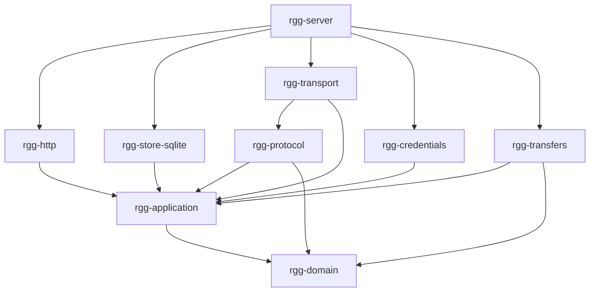

# Retro Gadu (rGG)

Nowy serwer protokołu Gadu-Gadu, pisany w Rust. Punktem odniesienia jest fork
`webs1821/gg-retro` 0.8.3. Rozwój odbywa się **wyłącznie lokalnie**, do czasu
osiągnięcia co najmniej jego zakresu funkcjonalnego. Plan nie stanowi dowodu
gotowej implementacji, a testy syntetyczne nie oznaczają kwalifikacji klienta GG.

## Aktualny stan

Wersja **0.1.0-dev.19**, schemat SQLite **11**, dziesięć modułów Rust.
Kod jest sprawdzany na Linux/WSL, na danych syntetycznych i portach loopback.
Oryginalnego klienta GG6 ani natywnego buildu Windows jeszcze nie kwalifikowano.

- Logowanie GG6, sesje, trwała kolejka online/offline, obecność, opisy,
  niewidoczność, prywatność, archiwa kontaktów i dobrowolny katalog publiczny.
- Formatowanie, konferencje oraz klasyczne obrazki pobierane od połączonego
  nadawcy, z autoryzacją odbiorcy, limitami i weryfikacją CRC.
- Opcjonalne lokalne discovery HTTP, rejestracja na zaproszenia, wybór numeru,
  strona główna, liczniki i katalog pobierania plików wskazanych w manifeście.
- Lokalne CLI: konta, rezerwacje usuniętych numerów, kompletne kopie i restore,
  rotacja kluczy z kopią i wznowieniem, zgodność starych kodów zaproszeń
  i uwierzytelniona zmiana hasła z ograniczonym audytem.
- Import przypiętej wersji gg-retro 0.8.3 do nowego katalogu: kontrola sekretów,
  ponowne szyfrowanie, zachowanie danych i liczników, transakcja oraz blokada
  startu po nieukończonym imporcie. Testowano wyłącznie sztuczną bazę.
- Lokalny generator klienta/instalatora GG6: adres z konfiguracji, wyłączony
  aktualizator, poprawione nazwy dźwięków i manifest pobierania z hashami.
  Przebudowa i zasoby Windows sprawdzone; plików EXE nie uruchamiano.
- HTTP ma limity gniazd globalnie/na IP oraz czasu bezczynności, zablokowanego
  zapisu i całego połączenia. Syntetyczny pomiar online/offline jest powtarzalny.
- Prywatne metryki na osobnym, opcjonalnym porcie loopback: sesje, kolejka,
  przechowywane rekordy i bajty. Ograniczone zapytania i stały zestaw etykiet.
- Przypięty lokalny obraz dev.19 z kompletem źródeł; sprawdzone 22 zestawy
  kontroli i krótki profil R0 (100 sesji, 10 wiadomości/s, 1 CPU/256 MiB).
  Starsza próba dev.18 obejmuje też trwały wolumen, restart i backup/restore.

[Macierz funkcjonalności i braków](docs/implementation/PARITY.md) oddziela
zaimplementowane przepływy od kwalifikacji natywnych klientów. Nadal wymagają
pracy m.in. granice uploadu kontaktów, kwalifikacja klienta i profil wdrożeniowy.

- [Szczegółowy plan](PLAN_IMPLEMENTACJI.md), [recenzje](docs/reviews/ROZLICZENIE_UWAG.md)
- [Dziennik implementacji](docs/implementation/STATUS.md), [punkt wznowienia](docs/implementation/RESUME.md)
- [Kontener lokalny](docs/implementation/CONTAINERS.md), [raport obrazu dev.18](docs/implementation/VERIFICATION-2026-11-01-container.md)
- [Profil R0](docs/implementation/R0-LOAD.md), [obraz dev.19 i pomiar R0](docs/implementation/VERIFICATION-2026-11-01-r0.md)
- [Prywatne metryki](docs/implementation/METRICS.md), [weryfikacja dev.19](docs/implementation/VERIFICATION-2026-11-01-dev19.md)
- [Ograniczenia HTTP](docs/implementation/HTTP-LIMITS.md), [weryfikacja dev.18](docs/implementation/VERIFICATION-2026-11-01-dev18.md)
- [Pakiet klienta](docs/implementation/CLIENT-PACKAGES.md), [weryfikacja dev.17](docs/implementation/VERIFICATION-2026-11-01-dev17.md)
- [Zmiana hasła](docs/implementation/PASSWORD-CHANGE.md), [weryfikacja dev.16](docs/implementation/VERIFICATION-2026-11-01-dev16.md)
- [Import gg-retro](docs/implementation/IMPORT-GG-RETRO.md), [weryfikacja dev.15](docs/implementation/VERIFICATION-2026-11-01-dev15.md)
- [Kopie i odtwarzanie](docs/implementation/BACKUPS.md), [rotacja kluczy](docs/implementation/KEY-ROTATION.md)
- [Sesje i kolejka](docs/implementation/SESSIONS-AND-DELIVERY.md), [obecność i kontakty](docs/implementation/PRESENCE-AND-CONTACTS.md)
- [Katalog publiczny](docs/implementation/PUBLIC-DIRECTORY.md), [konferencje](docs/implementation/CONFERENCES.md), [obrazki](docs/implementation/IMAGES.md)
- [Discovery](docs/implementation/HTTP-DISCOVERY.md), [rejestracja WWW](docs/implementation/WEB-REGISTRATION.md), [stare zaproszenia](docs/implementation/LEGACY-INVITATIONS.md)
- [Liczniki](docs/implementation/PUBLIC-STATISTICS.md), [pobieranie](docs/implementation/DOWNLOADS.md), [pochodzenie kodu](THIRD_PARTY.toml)

## Uruchomienie lokalne

Wymagania: Rust wskazany w `rust-toolchain.toml`, kompilator C dla SQLite oraz
Python 3.11+ do kontroli repozytorium. Bieżącą implementację uruchomiono i
przetestowano na Linuksie w WSL; natywnego buildu Windows jeszcze nie kwalifikowano.

```sh
cargo build --workspace --locked
cargo run --locked -p rgg-server -- --config config/rgg.example.toml
```

Sprawdzenie: `http://127.0.0.1:8088/health/ready`. Zakończenie: Ctrl+C lub SIGTERM.
Konfiguracja odrzuca adresy inne niż loopback i nieznane klucze.
Ścieżka danych jest względna względem pliku konfiguracji, nie katalogu uruchomienia.

Baza i lock są tworzone w podanym katalogu danych. Nie usuwaj `rgg.lock`, gdy
proces działa. Blokadę zwalnia zamknięcie uchwytu procesu, również po awarii.
W WSL zalecany jest katalog danych w linuksowym systemie plików, np.
`/tmp/rgg-dev-data` dla danych jednorazowych. Nie używaj NFS/SMB ani produkcyjnej bazy.

## Weryfikacja

```sh
python tools/verify_repository.py
python tools/gg32_vectors.py
python tests/client_package.py
cargo metadata --locked --format-version 1 | python tools/dependency_inventory.py
cargo fmt --all -- --check
cargo clippy --workspace --all-targets --locked -- -D warnings
cargo test --workspace --locked
cargo build --workspace --locked
python tests/lifecycle.py --binary target/debug/rgg-server
python tests/accounts_cli.py --admin target/debug/rgg-admin --server target/debug/rgg-server
python tests/gg6_sessions.py --admin target/debug/rgg-admin --server target/debug/rgg-server
python tests/gg6_presence_contacts.py --admin target/debug/rgg-admin --server target/debug/rgg-server
python tests/gg6_directory.py --admin target/debug/rgg-admin --server target/debug/rgg-server
python tests/http_discovery.py --admin target/debug/rgg-admin --server target/debug/rgg-server
python tests/legacy_import.py --admin target/debug/rgg-admin --server target/debug/rgg-server
cargo build --workspace --locked --features rgg-server/test-hooks
python tests/gg6_sessions.py --admin target/debug/rgg-admin --server target/debug/rgg-server --faults
python tests/gg6_presence_contacts.py --admin target/debug/rgg-admin --server target/debug/rgg-server --faults
cargo build --workspace --locked
cargo audit
```

Testy `lifecycle.py`, `accounts_cli.py` oraz zestawy `gg6_*.py` wymagają Linuksa/WSL i używają wyłącznie katalogu tymczasowego,
syntetycznej bazy i losowego portu loopback. Jeśli ustawiono `CARGO_TARGET_DIR`,
ścieżkę do pliku wykonywalnego należy odpowiednio zmienić.
Do audytu użyto `cargo-audit 0.22.2`, instalowanego przez
`cargo install cargo-audit --version 0.22.2 --locked`.

Funkcja kompilacji `test-hooks` jest przeznaczona wyłącznie do wymuszania awarii
w testach. Zwykły build nie odczytuje zmiennych `RGG_TEST_CRASH` ani
`RGG_TEST_DROP_WAKEUPS`. Ostatni build powyżej przywraca zwykły plik wykonywalny.

Workflow CI jest przygotowany jako plik lokalny. Nie został uruchomiony na GitHubie;
origin wskazuje webs1821/retro-gadu, ale w tych pracach nie wykonywano push.

## Lokalne konta i zaproszenia

Zatrzymaj proces rGG przed pracą narzędziem administratora. Oba programy
używają tej samej blokady katalogu; CLI odmawia dostępu, gdy działa serwer.
W Linux/WSL można przygotować jednorazowe dane testowe tak:

```sh
target/debug/rgg-admin init --data-dir /tmp/rgg-dev-data
target/debug/rgg-admin invite --data-dir /tmp/rgg-dev-data --count 2 --uses 3
python tools/create_account.py --admin target/debug/rgg-admin --data-dir /tmp/rgg-dev-data
target/debug/rgg-admin stats --data-dir /tmp/rgg-dev-data
```

Aby serwer używał tych samych danych, ustaw w jego konfiguracji
`data_dir = "/tmp/rgg-dev-data"`. Ten katalog służy wyłącznie jednorazowym próbom.

Po przygotowaniu kont w tym katalogu włącz port protokołu w lokalnej konfiguracji:

```toml
data_dir = "/tmp/rgg-dev-data"
http_bind = "127.0.0.1:8088"
gg_bind = "127.0.0.1:8074"
```

Uruchom `rgg-server --config <ścieżka-do-tego-pliku>`. Brak `gg_bind` oznacza
tryb samego HTTP. Po jego włączeniu serwer wymaga istniejącego `keys.toml` i
weryfikuje klucze kont przed otwarciem obsługi połączeń. Oba porty muszą wskazywać
loopback. Opcjonalne `legacy_discovery = true` w głównej sekcji konfiguracji
włącza endpointy appmsg3/appmsg4 dla GG6 i wymaga IPv4. Odpowiedź wskazuje
faktyczny lokalny port. Testy używają osobnych kont syntetycznych.

Interaktywny pomocnik przekazuje hasło i kod przez standardowe wejście,
bez umieszczania ich w argumentach procesu. Bezpośredni `account-create` przyjmuje
JSON na stdin: `requested_uin` (liczba albo null), `invite`, `password`, `email`.
Hasło na tym etapie ma 8–15 drukowalnych znaków ASCII bez spacji, zgodnie z polityką
dotychczasowego gg-retro. Adres e-mail zapisuje się jako **niezweryfikowany**.

Puste pole numeru oznacza pierwszy wolny numer od 112233. Numer ręczny może być
niższy; nie przesuwa automatycznego licznika do wysokiej wartości. Zaproszenie
jest zużywane dopiero wraz z zatwierdzeniem utworzenia konta. Kolizja numeru,
błąd szyfrowania i nieudana rejestracja nie zużywają zaproszenia.
CLI tworzy nowe kody rGG. Importer zachowuje stare hashe zaproszeń, ich użycia i aktywność.

`retire --uin <numer> --data-dir <katalog>` usuwa rekord konta i trwale rezerwuje
numer. Nie jest to obietnica usunięcia jego dawnych danych z kopii ani śladów
w plikach systemowych. Nie ma jeszcze interfejsu WWW ani zdalnego administratora.

Hasła są przechowywane w kopertach XChaCha20-Poly1305 z losowym nonce; powiązanie
z numerem, wersją i identyfikatorem klucza chroni przed podmienianiem rekordów.
Baza utrzymuje historię użytych par klucz–nonce także po usunięciu konta i odrzuca kolizję.
`keys.toml` musi być zachowany razem z informacją, do której bazy należy.
Na Linuksie program wymaga dostępu do pliku kluczy wyłącznie dla właściciela;
w WSL używaj linuksowego systemu plików. Brak lub niewłaściwy klucz dla istniejących
kont jest błędem, a nie powodem do wygenerowania zamiennika. Kopie, odtwarzanie
i rotacja kluczy są dostępnymi komendami offline; nie działają automatycznie.

## Podział kodu

| Moduł | Odpowiedzialność |
|---|---|
| `rgg-domain` | Identyfikatory i czyste reguły danych |
| `rgg-application` | Uwierzytelnianie, aktorzy kont, sesje, komendy i porty infrastruktury |
| `rgg-protocol` | Czyste dekodery/enkodery i reguły formatu GG |
| `rgg-store-sqlite` | Implementacja portów, migracje, trwałość i wyłączne posiadanie danych |
| `rgg-transport` | Nasłuch GG6, cykl połączenia, limity i pojedynczy writer sesji |
| `rgg-transfers` | Ograniczone transfery obrazków w RAM, weryfikacja CRC i sesji |
| `rgg-http` | Endpointy HTTP zależne od portów aplikacji |
| `rgg-server` | Konfiguracja, składanie modułów, sygnały i cykl życia |
| `rgg-credentials` | Koperty sekretów, keyring, losowe zaproszenia i ich skróty |
| `rgg-admin` | Lokalne konta, zaproszenia, kopie, rotacja kluczy i import pod blokadą danych |



Własny kod zabrania `unsafe`. Kontrola grafu zależności pilnuje m.in., aby SQLx i
Axum nie trafiały do domeny, aplikacji ani parsera. Kolejne moduły powstają wraz
z realną implementacją, zamiast pustych pakietów na zapas.

## Autorstwo i źródła

Własny kod: **webs1821**, AGPL-3.0-or-later. Pełna licencja w [LICENSE](LICENSE).
Funkcja GG32 została przeniesiona z poggadaj (Oreeeee); zachowano informację
o autorze, licencję, oryginalny plik, commit i jego sumę SHA-256. Pythonowy
generator wektorów również jest portem tego algorytmu, a nie niezależnym klientem.

Opis protokołu libgadu służy jako dokumentacja formatu, a gg-retro jako odniesienie
funkcjonalne. Kod biblioteki libgadu ani serwera gg-retro nie został skopiowany.
Każde przyszłe wykorzystanie fragmentu kodu wymaga odrębnego wpisu w
`THIRD_PARTY.toml`, zachowania licencji i wskazania konkretnych symboli.
Oryginalny gg-retro ma niestandardową licencję MIS, nie MIT.

Wersje zewnętrznych bibliotek Rust są przypięte w `Cargo.lock`. Ich własne
licencje pozostają w mocy; rejestr pochodzenia kodu źródłowego rGG nie zastępuje
inwentaryzacji tych zależności ani przyszłego audytu wydania.

Inwentaryzacja wersji, licencji deklarowanych w metadanych i sum źródeł znajduje się
w [dependencies.json](docs/implementation/dependencies.json), a wynik RustSec w
[raporcie audytu dev.16](docs/implementation/cargo-audit-2026-11-01-dev16.json).
Warstwa bazy używa bezpośrednio zgodnych wersji `sqlx-core` i `sqlx-sqlite`;
nie rozwiązuje zbędnych sterowników MySQL/PostgreSQL ani ich zależności.
Migracje są osadzone w programie i zachowują kontrolę sum przez migrator SQLx.
