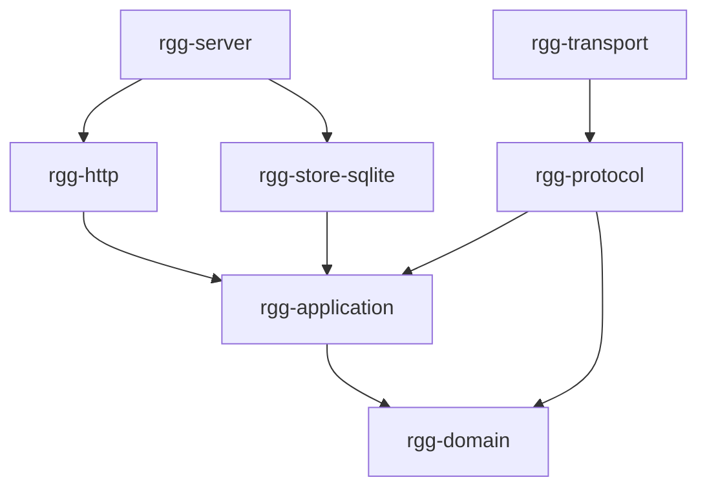

# Retro Gadu (rGG)

Nowy serwer protokołu Gadu-Gadu, pisany w Rust. Punktem odniesienia jest fork
`webs1821/gg-retro` 0.8.3. Rozwój odbywa się **wyłącznie lokalnie**, do czasu
osiągnięcia co najmniej jego zakresu funkcjonalnego. Plan nie stanowi dowodu
gotowej implementacji, a testy syntetyczne nie oznaczają kwalifikacji klienta GG.

## Aktualny stan

Pierwszy działający etap infrastruktury: osobne moduły, konfiguracja,
blokada katalogu danych na poziomie systemu operacyjnego, SQLite WAL/FULL,
migracje, identyfikator uruchomienia, HTTP live/ready i kontrolowane zamknięcie.
Są również fundamenty kodeka GG6, parser logowania i port GG32.

**Serwer nie obsługuje jeszcze kont ani rozmów GG.** Nie uruchamia publicznego
nasłuchu GG. TCP i przejście pakiet → komenda → zdarzenie → pakiet są obecnie
sprawdzane w odizolowanym teście integracyjnym.

- [Szczegółowy plan](PLAN_IMPLEMENTACJI.md)
- [Macierz funkcjonalności i braków](docs/implementation/PARITY.md)
- [Dziennik implementacji](docs/implementation/STATUS.md)
- [Pochodzenie użytych elementów](THIRD_PARTY.toml)
- [Recenzje planu](docs/reviews/ROZLICZENIE_UWAG.md)

## Uruchomienie lokalne

Wymagania: Rust wskazany w `rust-toolchain.toml`, kompilator C dla SQLite oraz
Python 3.11+ do kontroli repozytorium. Bieżącą implementację uruchomiono i
przetestowano na Linuksie w WSL; natywnego buildu Windows jeszcze nie kwalifikowano.

```sh
cargo build --workspace --locked
cargo run --locked -p rgg-server -- --config config/rgg.example.toml
```

Sprawdzenie: `http://127.0.0.1:8088/health/ready`. Zakończenie: Ctrl+C lub SIGTERM.
Konfiguracja odrzuca adresy inne niż loopback i nieznane klucze.
Ścieżka danych jest względna względem pliku konfiguracji, nie katalogu uruchomienia.

Baza i lock są tworzone w podanym katalogu danych. Nie usuwaj `rgg.lock`, gdy
proces działa. Blokadę zwalnia zamknięcie uchwytu procesu, również po awarii.
W WSL zalecany jest katalog danych w linuksowym systemie plików, np.
`/tmp/rgg-dev-data` dla danych jednorazowych. Nie używaj NFS/SMB ani produkcyjnej bazy.

## Weryfikacja

```sh
python tools/verify_repository.py
python tools/gg32_vectors.py
cargo fmt --all -- --check
cargo clippy --workspace --all-targets --locked -- -D warnings
cargo test --workspace --locked
cargo build --workspace --locked
python tests/lifecycle.py --binary target/debug/rgg-server
```

Ostatni test wymaga Linuksa/WSL i używa wyłącznie katalogu tymczasowego,
syntetycznej bazy i losowego portu loopback. Jeśli ustawiono `CARGO_TARGET_DIR`,
ścieżkę do pliku wykonywalnego należy odpowiednio zmienić.

Workflow CI jest przygotowany jako plik lokalny. Nie został uruchomiony na GitHubie;
repozytorium nie ma jeszcze zdalnego adresu.

## Podział kodu

| Moduł | Odpowiedzialność |
|---|---|
| `rgg-domain` | Identyfikatory i czyste reguły danych |
| `rgg-application` | Komendy, zdarzenia, przypadki użycia i porty infrastruktury |
| `rgg-protocol` | Czyste dekodery/enkodery i reguły formatu GG |
| `rgg-store-sqlite` | Implementacja portów, migracje, trwałość i wyłączne posiadanie danych |
| `rgg-transport` | Adapter strumienia TCP do ograniczonych ramek |
| `rgg-http` | Endpointy HTTP zależne od portów aplikacji |
| `rgg-server` | Konfiguracja, składanie modułów, sygnały i cykl życia |



Własny kod zabrania `unsafe`. Kontrola grafu zależności pilnuje m.in., aby SQLx i
Axum nie trafiały do domeny, aplikacji ani parsera. Kolejne moduły powstają wraz
z realną implementacją, zamiast pustych pakietów na zapas.

## Autorstwo i źródła

Własny kod: **webs1821**, AGPL-3.0-or-later. Pełna licencja w [LICENSE](LICENSE).
Funkcja GG32 została przeniesiona z poggadaj (Oreeeee); zachowano informację
o autorze, licencję, oryginalny plik, commit i jego sumę SHA-256. Pythonowy
generator wektorów również jest portem tego algorytmu, a nie niezależnym klientem.

Opis protokołu libgadu służy jako dokumentacja formatu, a gg-retro jako odniesienie
funkcjonalne. Kod biblioteki libgadu ani serwera gg-retro nie został skopiowany.
Każde przyszłe wykorzystanie fragmentu kodu wymaga odrębnego wpisu w
`THIRD_PARTY.toml`, zachowania licencji i wskazania konkretnych symboli.
Oryginalny gg-retro ma niestandardową licencję MIS, nie MIT.

Wersje zewnętrznych bibliotek Rust są przypięte w `Cargo.lock`. Ich własne
licencje pozostają w mocy; rejestr pochodzenia kodu źródłowego rGG nie zastępuje
inwentaryzacji tych zależności ani przyszłego audytu wydania.
