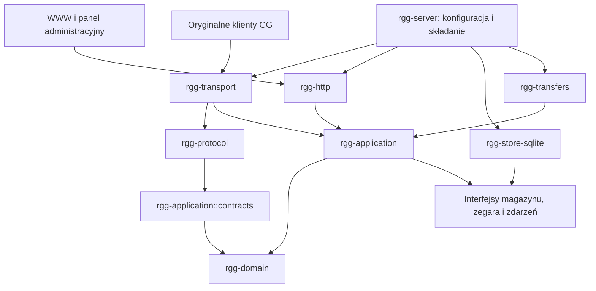

# Retro Gadu (rGG) — szczegółowy plan implementacji

Data: 2026-10-31. Wersja dokumentu: 0.2, po pierwszej rundzie trzech niezależnych przeglądów, do sprawdzenia poprawek.

Właściciel projektu: **webs1821**. Katalog projektu: `D:\Dokumenty\Documents\RetroGadu`.

Ten dokument określa projekt docelowy, kolejność prac i kryteria odbioru. Opisane funkcje są wymaganiami do zaimplementowania; dokument nie potwierdza, że już działają. Robocze eksperymenty nie stanowią zatwierdzonej architektury ani gotowej wersji serwera.

## 1. Cel, decyzje i granice projektu

### 1.1. Cel użytkowy

Retro Gadu ma być samodzielnym, otwartym serwerem umożliwiającym korzystanie z oryginalnych klientów Gadu-Gadu. Priorytetem jest możliwie pełna, sprawdzona zgodność funkcjonalna, trwałe wiadomości offline i poprawne zachowanie prywatności. Kolejne generacje klientów korzystają z tych samych kont i wspólnej logiki serwera.

Projekt powstaje od początku: własna struktura, model danych, kontrakty między modułami i historia Git. Można świadomie przenosić konkretne rozwiązania oraz fragmenty innych projektów, pod warunkiem zapisania ich pochodzenia i spełnienia warunków licencji. Całego forka gg-retro nie kopiujemy jako nowego projektu.

### 1.2. Ustalone decyzje

| ID | Decyzja | Konsekwencja |
| --- | --- | --- |
| D01 | Nazwa Retro Gadu, skrót rGG | Repozytorium i dokumentacja używają jednej nazwy; pakiety Rust mają prefiks `rgg-`. |
| D02 | Rust, asynchroniczna obsługa I/O przez Tokio | Własny kod bez `unsafe`; parsowanie pakietów oddzielone od transportu. |
| D03 | Jeden proces z wydzielonymi modułami i wyłączną blokadą katalogu danych | Blokada obejmuje serwer oraz narzędzia offline; pierwsze wydanie nie wymaga brokera ani klastra. |
| D04 | SQLite jako pierwsza implementacja magazynu | Transakcje, WAL, kontrola integralności, spójne kopie; PostgreSQL dopiero przy uzasadnionej potrzebie. |
| D05 | GG 6.0 i 6.1 jako pierwsze profile zgodności | Najpierw pełna ścieżka logowania i rozmowy w tych klientach, następnie rozszerzanie zakresu. |
| D06 | Trwała kolejka przed potwierdzeniem przyjęcia | Awaria procesu po potwierdzeniu nadawcy nie może usuwać zapisanego zobowiązania serwera. |
| D07 | Obrazki działają klasycznie | Pierwszy odbiór wymaga dostępnego nadawcy; trwały cache obrazków nie jest domyślną funkcją. |
| D08 | Prywatność jest wspólną regułą domenową | Kontakty, katalog, wiadomości i transfery używają jednej polityki uprawnień. |
| D09 | Kod własny: AGPL-3.0-or-later | Pozwala rozwijać otwarty serwer i włączać zgodne fragmenty poggadaj z zachowaniem ich autorstwa. |
| D10 | Każda pożyczona implementacja ma wpis pochodzenia | Plik, commit, licencja, autor, lokalne zastosowanie i zakres modyfikacji są wskazane w repozytorium. |
| D11 | Najpierw środowisko lokalne i testowe | Działający gg-retro pozostaje osobnym systemem; wdrożenie rGG wymaga przejścia bramek wydania. |
| D12 | Commit autora zmian: webs1821 | Nie zmieniamy autorstwa zapożyczonego kodu; scalone gałęzie robocze są usuwane po zachowaniu historii i kopii. |

### 1.3. Zakres kolejnych generacji

1. Pełny zestaw podstawowych funkcji GG 6.0/6.1 oraz funkcje dostępne w tych klientach.
2. GG 7.0/7.1, 7.5/7.6 i 7.7, z oddzielnymi profilami tam, gdzie zachowanie się różni.
3. Starsze GG 3.x, 4.0–4.6, 4.8.x i 5.0: konkretne dostępne wydania, każde zweryfikowane osobno.
4. GG 8.x/10.x: osobny etap, obejmujący nowe formaty pakietów, kontakty i możliwości sesji.
5. Jeszcze nowsze generacje: najpierw rozpoznanie rzeczywistego zakresu dokumentacji i dostępnych klientów. Brak deklaracji obsługi przed testami.

Numery marketingowe wersji nie wystarczają do doboru zachowania. Profil uwzględnia numer protokołu, pola możliwości, wariant logowania oraz zaobserwowane różnice konkretnego wydania klienta.

### 1.4. Poza pierwszym wydaniem

- Federacja między prywatnymi serwerami, łączenie z oficjalną siecią GG i odtwarzanie usług reklamowych.
- Rozproszony klaster, automatyczne przełączanie między kilkoma aktywnymi serwerami i wiele backendów bazy jednocześnie.
- Domyślne przechowywanie całej historii rozmów na serwerze.
- Obietnica szyfrowania end-to-end dla niezmodyfikowanych starych klientów.
- Deklaracja działania rozmów głosowych, kamer lub wszystkich transferów P2P przed odrębnym rozpoznaniem i testami.
- Automatyczne publikowanie profili użytkowników w katalogu.

## 2. Mierzalne zasady poprawności

| ID | Zasada obowiązująca w całym systemie |
| --- | --- |
| I01 | Potwierdzenie przyjęcia wiadomości następuje dopiero po zatwierdzeniu transakcji zapisu. |
| I02 | Sukces zapisu do gniazda nie jest zapisywany jako potwierdzenie odbioru przez aplikację ani przeczytania przez człowieka. |
| I03 | Stara sesja nie może zmienić stanu nowej sesji tego samego konta ani potwierdzić jej dzierżaw wiadomości. |
| I04 | Awaria i restart nie zmieniają kont, liczników zaproszeń, list kontaktów ani własności profili. |
| I05 | Zablokowany lub nieuprawniony nadawca nie uzyskuje dostępu do wiadomości, obrazka, transferu ani informacji o obecności przez alternatywny endpoint. |
| I06 | Niepełny pakiet TCP nie jest traktowany jako pełny; nadmiarowy pakiet jest odrzucany przed dużą alokacją. |
| I07 | Każda kolejka w pamięci, operacja na sieci i zapytanie użytkownika mają limit oraz zdefiniowane zachowanie po jego przekroczeniu. |
| I08 | Pochodzenie skopiowanego lub przetłumaczonego kodu można ustalić z samego repozytorium. |
| I09 | Test zgodności nie może opierać się wyłącznie na parserze i serializerze napisanych razem w rGG. |
| I10 | Konfiguracja nie zawiera na stałe domeny właściciela ani jego adresów IP. |
| I11 | Niewspierana funkcja kończy się świadomą odpowiedzią albo udokumentowanym zachowaniem, bez pozornego sukcesu i cichej utraty danych. |
| I12 | Cofnięcie wdrożenia po wznowieniu ruchu nie może automatycznie odtworzyć starej bazy kosztem nowych zapisów użytkowników. |

## 3. Architektura i kierunek zależności



- `rgg-domain`: typy, walidacja i czyste reguły; bez Tokio, HTTP, SQL i struktury pakietów.
- `rgg-protocol`: pakiety i adaptery wersji; używa domeny oraz transportowo niezależnych `rgg-application::contracts`, nie otwiera połączeń ani bazy.
- `rgg-application`: przypadki użycia, polityki, koordynacja sesji i interfejsy wymaganych usług.
- Implementacje infrastruktury zależą od interfejsów aplikacji. Aplikacja nie importuje `sqlx::Pool` ani typów Axum.
- `rgg-server` składa implementacje. Zmiana transportu lub bazy nie powinna wymagać zmiany reguły widoczności kontaktu.
- Moduły o małej ilości kodu mogą początkowo być modułami jednego crate. Wydzielenie kolejnego crate ma wynikać z rzeczywistej granicy zależności, nie z samej liczby katalogów.

Właścicielem `Command`, `Event` i DTO wyników jest `rgg-application::contracts`. Aplikacja nie zależy od protokołu, transportu, Axum ani SQLx. Nazwy takie jak budowanie strony katalogu w aplikacji oznaczają model wyniku; kodowanie go do bajtów należy wyłącznie do adaptera. Test grafu zależności ma egzekwować ten kierunek, również pośrednio przez zależności runtime.

### 3.1. Docelowa struktura repozytorium

```text
RetroGadu/
  Cargo.toml, Cargo.lock
  LICENSE, README.md, CONTRIBUTING.md, SECURITY.md
  PLAN_IMPLEMENTACJI.md
  THIRD_PARTY.toml
  LICENSES/
  config/rgg.example.toml
  crates/
    rgg-domain/src/{identity,message,presence,contacts,directory,errors}.rs
    rgg-protocol/src/{frame,capabilities,encoding,legacy_hash}.rs
    rgg-protocol/src/versions/{gg3,gg4,gg5,gg6,gg7,gg77,gg8,gg10}/
    rgg-application/src/{accounts,auth,sessions,messaging,delivery,...}/
    rgg-application/src/ports/{store,clock,notifications,secrets}.rs
    rgg-store-sqlite/{src,migrations}/
    rgg-transport/src/{listener,connection,reader,writer,shutdown}.rs
    rgg-http/src/{legacy,public,self_service,admin,middleware}/
    rgg-transfers/src/{offers,images,dcc,relay}/
    rgg-server/src/{main,config,bootstrap,supervision}.rs
    rgg-admin/src/{main,accounts,invites,backup,migrate}.rs
  tests/{wire,scenarios,fixtures,interop,faults,migration}/
  tools/{verify_provenance,check_architecture,release_manifest,...}
  docs/{architecture,protocol,operations,decisions,reviews}/
  third_party/                 # tylko konkretne, opisane materiały
  deploy/{Dockerfile,compose.yaml,nginx.example.conf}/
```

Puste katalogi planowanych generacji nie muszą trafiać do Git. Zależności i pliki pojawiają się razem z implementacją. Kod aplikacji, narzędzia operatora i dane runtime mają oddzielne lokalizacje.

### 3.2. Własność stanu, współbieżność i punkty atomowe

Wybrany model: jeden właściciel stanu na konto (`AccountActor`), osobny writer na sesję i ograniczony koordynator operacji między kontami. Actor serializuje komendy dotyczące własnego stanu, łącznie z zakończeniem wymaganych zapisów DB. Nie oczekuje na wynik innego actora. Koordynator przekazuje komendy i zbiera odpowiedzi poza pętlami kont, z limitem równoległych operacji, deadline i regułą anulowania. Dotyczy to również dwukierunkowej rozmowy, konferencji i transferów.

Komenda niesie uwierzytelnioną tożsamość, `SessionId`, generację sesji i wersję poświadczeń. Sprawdzenie w pamięci przed `await` nie jest wystarczające. Magazyn wykonuje warunkową mutację razem ze sprawdzeniem wymaganych wersji, stanu konta i rewizji zasad. Zmiana sesji oraz komenda nie mogą przejść na podstawie dwóch niezależnych, nieaktualnych odczytów.

| Operacja | Punkt rozstrzygnięcia |
| --- | --- |
| Dołączenie sesji | Atomowe porównanie wersji poświadczeń i aktywności konta oraz przydział nowej generacji. Nieaktualny wynik weryfikacji hasła jest odrzucany. |
| Zmiana hasła, blokada lub usunięcie | Jedna transakcja zwiększa wersję odwołania uprawnień/generację, zapisuje zmianę i unieważnia właściwe sesje WWW/tokeny. Stare komendy po tej granicy nie mogą zatwierdzić skutku. |
| Mutacja kontaktów/opisu/prywatności | Warunkowy commit aktualnej generacji i wymaganej rewizji. Starsza komenda kończy się przed przejęciem albo otrzymuje konflikt, nigdy nie nadpisuje nowego stanu po nim. |
| Przyjęcie wiadomości | Atomowa operacja magazynu sprawdza wymagane uprawnienia/wersje, limity i zapisuje całość. Zatwierdzone przed odwołaniem zobowiązanie pozostaje rozliczane zgodnie z późniejszą polityką odbiorcy. |

### 3.3. Odwołanie prawa do I/O i granica prywatności

Ramka w buforze writera ma `SessionId`, generację, rewizję polityki, a przy doręczeniu także identyfikator próby, token i deadline. Wymiana sesji, utrata dzierżawy lub zmiana polityki zatrzymują dopuszczanie odpowiednich nowych zapisów. Bariera potwierdza, że stary writer nie rozpocznie już zapisu anulowanych ramek. Samo zakończenie producenta albo odmowa SQL staremu tokenowi nie stanowią takiej bariery.

Zmiana prywatności jest uporządkowana z dopuszczaniem ramek: zamknięcie bramki dispatch → bariera dla nierozpoczętych ramek → transakcja nowej rewizji → publikacja rewizji i ponowne otwarcie bramki dla dozwolonych zdarzeń. Przy błędzie transakcji przywracana jest poprzednia polityka. Nie trzymamy transakcji SQL ani globalnego mutexa podczas bariery.

Bajtów już oddanych TCP nie można cofnąć. Rozpoczęta ramka ma ograniczony czas zakończenia; w razie anulowania lub timeoutu po częściowym zapisie zamykamy strumień, zamiast dopisywać do niepełnej ramki następny pakiet. Zmiana blokady nie jest obietnicą cofnięcia wcześniej wysłanej wiadomości.

Przed nową próbą po utracie lease trzeba potwierdzić utratę starego prawa do I/O. Deadline obejmuje także czekanie w buforze i nie przekracza pozostałego czasu dzierżawy. Bariera i zatrzymanie writera mają ograniczony czas oraz eskalację do nadzoru procesu. Sygnał zakończenia I/O nie czeka na opróżnienie callbacków przez actor, który właśnie oczekuje na tę barierę. Spóźnione raporty writera są obsługiwane później przez monotoniczny CAS.

### 3.4. Wyłączność procesu, zegary i porty transakcyjne

Serwer utrzymuje blokadę systemową katalogu danych przez cały czas życia, przed otwarciem bazy i listenerów. Drugie uruchomienie na innych portach z tym samym katalogiem odmawia startu. Ten sam mechanizm obowiązuje narzędzia offline. Nie jest to wyłącznie plik PID; awaria właściciela musi pozwalać systemowi operacyjnemu zwolnić blokadę.

Każdy start ma nową `ProcessEpoch`. Po uzyskaniu wyłączności próby poprzedniej epoki nie mają żywego writera i można je odzyskać bez czekania na odległy czas ścienny. W działającym procesie deadline I/O używa zegara monotonicznego. Zapisane terminy TTL są czasem UTC; cofnięcie i skok zegara mają testowaną politykę i alarm, nie mogą uruchamiać równoległych właścicieli tego samego I/O.

Porty magazynu odpowiadają atomowym przypadkom użycia: `register_with_invite`, `attach_session_if_current`, `revoke_credentials`, `accept_message_bundle`, `claim_delivery`, `transition_delivery`, `create_reset_with_outbox`. Aplikacja nie składa kilku niezależnych repozytoriów z nadzieją na jedną transakcję i nie otrzymuje typu SQLx. Wewnętrzny `with_transaction` pozostaje szczegółem implementacji magazynu.

## 4. Szczegółowy podział modułów i kontraktów

Nazwy funkcji niżej opisują docelową odpowiedzialność. Ich dokładne sygnatury zostaną ustalone przy realizacji etapu, z zachowaniem podanych niezmienników.

### M01. Konfiguracja, uruchomienie i nadzór — `rgg-server`

**Odpowiedzialność:** odczyt konfiguracji, walidacja powiązanych ustawień, złożenie usług i kontrolowane zatrzymanie.

| Funkcja | Kontrakt |
| --- | --- |
| `load_config(path)` | Odczytuje TOML, odrzuca nieznane klucze i ustala ścieżki względem katalogu konfiguracji. |
| `validate_config(config)` | Sprawdza porty, limity, adres reklamowany klientom, źródła kluczy, dostępność katalogów i niesprzeczność ustawień. |
| `bootstrap(config)` | Otwiera bazę, sprawdza wersję schematu, uruchamia wymagane zadania i dopiero potem ustawia gotowość. |
| `supervise(tasks)` | Awaria kluczowego zadania obniża gotowość i inicjuje kontrolowane wyłączenie; nie zostawia pozornie zdrowej połowy serwera. |
| `shutdown(reason,deadline)` | Wstrzymuje przyjmowanie nowych żądań, kończy zapisane operacje, zamyka sesje i raportuje niedokończone zadania. |

Domyślna konfiguracja deweloperska nasłuchuje na loopback. Wartości reklamowane przez HTTP mogą różnić się od bind address, ale muszą być jawne. Sekrety są ładowane z plików; nie są drukowane wraz z konfiguracją ani przekazywane w argumentach procesu.

### M02. Typy i walidacja — `rgg-domain`

- `UserId`: niezerowy identyfikator domenowy; ograniczenia starego klienta narzuca adapter, a nie globalny typ.
- `MessageId`: wewnętrzny, trwały identyfikator niezależny od numeru sekwencji GG.
- `SessionId` i `SessionGeneration`: identyfikują konkretne logowanie oraz aktualne uprawnienie do zmiany stanu konta.
- `MessageEnvelope`: nadawca, odbiorca, czas przyjęcia, identyfikator, pochodzenie i treść.
- `MessageContent`: tekst, opis formatowania, odwołania do obrazków i kontekst konferencji; implementowane etapami, bez ignorowania nieobsłużonych pól.
- `MessageSemantics`: typowane cechy wiadomości użytkownika i polityka odpowiedzi nadawcy, wynikające z klasy oraz maski flag protokołu. Komendy sterujące transferem są innymi komendami, także gdy korzystają z tego samego rodzaju pakietu.
- `Presence`: dostępność, opis, tryb widoczności, opcjonalny czas powrotu.
- `ClientCapabilities`: faktycznie rozpoznane możliwości, niezależne od samej nazwy wersji.
- `OperationError`: stabilna kategoria domenowa, mapowana osobno na HTTP i błędy konkretnego protokołu.

Funkcje: `UserId::try_from`, `MessageText::validate`, `validate_conference`, `normalize_profile`, `evaluate_visibility`. Typy zawierające hasło, tekst rozmowy lub token nie ujawniają zawartości przez domyślne `Debug`.

### M03. Ramki i bezpieczne parsowanie — `rgg-protocol::frame`

Funkcje: `decode_frame`, `encode_frame`, `finish_stream`, `validate_length`, `PacketCursor::{read_u16,read_u32,read_cstring,remaining}`.

- Obsługa dowolnego podziału nagłówka i treści między odczyty oraz kilku pakietów w jednym odczycie.
- Kontrola arytmetyki długości przed alokacją, limit całego pakietu i limit zależny od typu pakietu.
- Nieznany typ pakietu jest rozpoznanym wynikiem; decyzję o odrzuceniu lub pominięciu podejmuje profil zgodności.
- Parser raportuje typ i kategorię błędu, nie pełną treść pakietu.
- EOF w środku ramki jest odróżniony od poprawnego zamknięcia po pełnym pakiecie.
- Parsery danych z sieci mają testy wszystkich skróceń wejścia oraz fuzzing.

### M04. Adaptery generacji — `rgg-protocol::versions`

Kontrakt adaptera:

| Funkcja | Wynik |
| --- | --- |
| `recognize_login(frame)` | Kandydat profilu, metoda uwierzytelniania, pola możliwości; nie uznaje klienta za uwierzytelnionego. |
| `decode_command(frame,context)` | Typowana operacja aplikacji z zachowaniem wymaganych danych i ograniczeń klienta. |
| `encode_event(event,context)` | Jeden lub kilka pakietów dostosowanych do odbiorcy. |
| `encode_error(error,context)` | Odpowiedź możliwa do zrozumienia przez dany klient. |
| `map_presence(presence,viewer)` | Reprezentacja statusu po wcześniejszym zastosowaniu polityki prywatności. |
| `delivery_capabilities()` | Informacja, czy klient potwierdza odbiór, obsługuje synchronizację sesji i jakie ma ograniczenia. |

Każdy profil zawiera tabelę obsługiwanych operacji, znane wyjątki i odnośniki do fixture oraz testu z klientem. Profil rozpoznany w czasie logowania nie może później samowolnie uzyskać wyższych uprawnień przez wysłanie pakietu nowszego protokołu.

### M05. Kodowanie tekstu i formatowania

Funkcje: `decode_legacy_text`, `encode_for_client`, `translate_format_spans`, `validate_rich_text`, `validate_image_references`.

- Wewnętrznie tekst jest Unicode. Bajty CP1250 pozostają szczegółem adaptera.
- Pozycje formatowania mogą być liczone w bajtach tekstu klienta; nie wolno przenosić offsetów między kodowaniami bez przeliczenia.
- NUL, niepoprawne offsety, nieznane atrybuty i zbyt długie pola mają jawne reguły.
- Początkowa polityka nieprzedstawialnego znaku: odmowa operacji z czytelnym błędem tam, gdzie protokół na to pozwala. Konwersja z utratą znaków wymaga osobnej, jawnej decyzji produktu.
- Przy rozmowie różnych generacji formatowanie jest zachowywane tam, gdzie odbiorca je obsługuje; zachowanie dla pozostałych atrybutów jest częścią testowanego profilu.

### M06. Transport i połączenia — `rgg-transport`

Funkcje: `accept_connection`, `read_frames`, `write_frames`, `enforce_connection_budget`, `drain_connection`, `close_connection`.

- Jedna kontrolowana ścieżka zapisu na sesję; pakiety z różnych źródeł nie mogą przeplatać swoich bajtów.
- Ograniczone bufory wejścia i wyjścia. Wolny klient nie blokuje globalnego mutexa, innych kont ani transakcji bazy.
- Czas na powitanie, logowanie, uzupełnienie początkowego stanu, bezczynność i zapis jest ograniczony.
- Odczyt strumienia pozostaje poprawny przy anulowaniu oczekiwania przez `select` lub shutdown.
- Limity ogólne i per adres IP są nakładane przed kosztownymi operacjami.
- Utrata TCP nie usuwa kolejki i nie wywołuje ponownego przyjęcia tej samej komendy bez decyzji warstwy aplikacji.

### M07. Konta i rejestracja — `application::accounts`

Funkcje: `register_account`, `allocate_number`, `reserve_requested_number`, `consume_invitation`, `change_password`, `delete_account`, `disable_account`.

- Opcjonalny ręczny numer: unikalność, zakres zgodny z włączonymi profilami, jednoznaczna normalizacja.
- Brak numeru: rosnący przydział od 112233; niższe numery wyłącznie na żądanie. Usunięcie konta nie cofa licznika.
- Zaproszenia: domyślnie 3 udane rejestracje; limit i aktywność trwałe. Nieudana rejestracja nie zużywa kodu.
- Rezerwacja numeru, sprawdzenie unikalności, utworzenie konta, zwiększenie licznika zaproszenia i przesunięcie automatycznego numeru są jedną transakcją.
- Wyścigi identycznego numeru, adresu e-mail i ostatniego użycia zaproszenia mają tylko jednego zwycięzcę.
- Usunięcie i blokada konta mają zdefiniowany wpływ na aktywne sesje, profil, kontakty, kolejkę i dzierżawy.

Usunięty numer pozostaje zarezerwowany przez minimalny tombstone UIN. Pierwsza wersja nie przydziela go ponownie ani ręcznie, ani automatycznie; inna osoba nie może odziedziczyć starych kontaktów i zaufania. Dane osobowe są usuwane oddzielnie od rezerwacji numeru. Tombstone jest zachowywany podczas backupu, importu i przywracania. Konto usunięte nie przyjmuje logowania, wiadomości ani ofert.

### M08. Uwierzytelnianie i sekrety — `application::auth`

Funkcje: `issue_challenge`, `verify_legacy_response`, `verify_web_password`, `rotate_credential_key`, `begin_password_reset`, `consume_reset_token`.

- Losowe challenge dla każdej sesji; brak stałego ziarna i brak logowania odpowiedzi hasłowej.
- GG32 i późniejsze mechanizmy logowania są implementowane zgodnie z profilem. Zwykły hash Argon2 nie zastąpi sekretu potrzebnego do wyliczenia legacy challenge response.
- Sekret wymagany przez stary protokół: szyfrowanie uwierzytelnione, klucz poza bazą, powiązanie ciphertext z identyfikatorem konta i wersją formatu przez AAD.
- Osobne hasła panelu administracyjnego: Argon2id i niezależna polityka sesji. Brak wspólnego klucza dostępowego administratora i starego klienta GG.
- Jawna polityka kodowania hasła dla starszych i nowych profili; niedozwolona jest cicha zamiana znaków.
- Porównania odpowiedzi bez zależności czasu od pierwszego różniącego się bajtu.
- Ochrona przed zgadywaniem: limity na połączenie/IP i kontrolowane opóźnienia; blokada publicznie znanego numeru nie może być prostym sposobem na trwałe odcięcie jego właściciela.
- Reset: token o wysokiej entropii, zapis skrótu, czas ważności i pojedyncze użycie. Wiadomości e-mail przez trwały outbox, bez wysyłania hasła.

Format sekretu legacy: wersjonowana koperta XChaCha20-Poly1305 z losowym 24-bajtowym nonce z systemowego CSPRNG, `key_id` i AAD zawierającym przeznaczenie, wersję formatu oraz identyfikator konta. Implementacja używa sprawdzonej biblioteki, z przypiętą wersją i audytem przed E02. Błąd losowości, brak klucza lub błąd AEAD powoduje odmowę bez fallbacku do plaintext. Unikalność nonce jest kontrolowana dla klucza; wykryta kolizja jest błędem/retry przed zapisem, nigdy ponownym użyciem pary key/nonce.

Keyring rozróżnia aktywny klucz zapisu i starsze klucze odczytu. Rotacja jest wznawialna, raportuje rekordy wymagające migracji i nie usuwa klucza potrzebnego przez zachowany backup. Keyring ma odrębną chronioną kopię i manifest `key_id`; kopia samej bazy nie jest kompletem odtworzeniowym. Zamiana ciphertext między kontami, uszkodzenie AAD, przerwana rotacja i brak klucza są obowiązkowymi testami. Szyfrowanie bazy chroni przed utratą samej bazy, nie przed jednoczesnym przejęciem kluczy i procesu.

Zmiana/reset hasła, blokada i usunięcie unieważniają wersję uprawnień. Dołączenie sesji sprawdza ponownie wersję używaną do weryfikacji. Jeśli samoobsługa WWW i legacy reprezentują to samo hasło użytkownika, verifier WWW i zaszyfrowany sekret legacy zmieniają się atomowo. Administrator ma niezależne poświadczenia.

### M09. Sesje i generacje połączeń — `application::sessions`

Stany: `Connected → Challenged → Authenticating → LoadingInitialState → Ready → Draining → Closed`.

Funkcje: `begin_session`, `authenticate_session`, `attach_account`, `finish_initial_state`, `replace_session`, `detach_session`, `session_is_current`.

- Pierwszy zakres: jedna aktywna sesja na konto, z jasno określonym zastępowaniem starej sesji.
- Wpis sesji zawiera generację; zakończenie starego zadania nie usuwa nowego wpisu.
- Konto staje się gotowe do publikacji obecności i doręczania dopiero po odtworzeniu trwałych zasad prywatności i poprawnym przetworzeniu początkowej listy klienta.
- Brak początkowego stanu kończy się timeoutem lub udokumentowaną bezpieczną polityką, nigdy nieograniczonym czekaniem.
- Wielosesyjność jest rozszerzeniem modelu, a nie równoległym ponownym użyciem mapy pojedynczej sesji. Musi określać sesję podstawową, zakres kopii i potwierdzenia per urządzenie.

Pierwszy kontrakt prywatności, wersja zasad i bramka `Ready` powstają już w E02–E03. E04 rozszerza je o pełne kontakty i widoczność. Testowa polityka `allow-all` nie jest opcją produkcyjnej konfiguracji. Każdy profil ma listę operacji dozwolonych w poszczególnych stanach, w tym zachowanie pakietu wiadomości/katalogu przed uwierzytelnieniem, powtórnego loginu i próby zmiany profilu w istniejącej sesji.

### M10. Przyjmowanie wiadomości — `application::messaging`

Funkcje: `accept_message`, `authorize_recipient`, `validate_content`, `persist_message`, `notify_delivery_worker`, `map_sender_result`.

Kolejność dla trwałej wiadomości użytkownika: uwierzytelniony nadawca → walidacja → polityka odbiorcy → limity → transakcja zapisu → odpowiedź przyjęcia, jeśli klient jej żąda → sygnał do doręczenia.

- Nadawca wynika z sesji; pole nadawcy w danych klienta nie jest autorytetem.
- Brak konta, pełna skrzynka, blokada i nieobsługiwany format mają rozróżnione wyniki wewnętrzne; odpowiedź na sieci nie może służyć do obchodzenia prywatności.
- Sygnał w pamięci jest tylko przyspieszeniem. Utrata sygnału po zatwierdzeniu zapisu nie może zatrzymać wiadomości bezterminowo: worker sprawdza trwałą kolejkę przy logowaniu, po wznowieniu i okresowo.
- Sekwencja klienta nie jest globalnie unikalnym identyfikatorem. Nie wprowadzamy globalnego `UNIQUE(sender, seq)`.
- Ewentualna deduplikacja retransmisji wymaga zbadanej semantyki konkretnego profilu, ograniczonego zakresu sesji i czasu oraz porównania treści. Do tego czasu brak pozornej gwarancji idempotencji.

`accept_message_bundle` zapisuje atomowo payload, kontekst konferencji, wszystkie wymagane oferty obrazków danego przyjęcia, stan doręczenia, kolejność oraz naliczenie limitów. Nie może istnieć potwierdzona wiadomość z brakującą ofertą wskutek osobnego późniejszego INSERT. Zakres pojedynczej transakcji odpowiada temu, czy dany klient sam wykonuje kopie konferencji, czy protokół przewiduje serwerowy fan-out.

Przed M10 adapter rozdziela tekst od żądań/fragmentów obrazków i innych komend sterujących. Maski `msgclass` nie są enumem wzajemnie wykluczających się wartości. Bit oznaczający brak żądania ACK jest respektowany; wejściowy bit odbiorczy QUEUED nie jest dowodem ani uprawnieniem. Przyjęcie trwałej treści wymaga commit również wtedy, gdy klient nie chce odpowiedzi. Ulotna komenda transferu nie trafia automatycznie do kolejki tekstowej. Każdy profil ma tabelę wynik domenowy → dozwolony status ACK/odmowa/brak odpowiedzi, sprawdzoną także w UI klienta.

### M11. Trwała kolejka i doręczanie — `application::delivery`

Funkcje: `lease_next`, `renew_lease`, `release_lease`, `record_transport_write`, `confirm_client_receipt`, `recover_expired_leases`, `expire_message`.

Każde przejęcie wiadomości otrzymuje losowy token i generację sesji. Potwierdzenie lub usunięcie wymaga aktualnego tokenu, identyfikatora wiadomości i właściwego odbiorcy. Dzierżawa wygasa, a dawny właściciel nie może potwierdzić nowej próby.

FIFO dotyczy **aktywnej kolejki** jednego odbiorcy według atomowo przydzielanego `enqueue_order`, nie samego timestampu. Aktywna dzierżawa pierwszej dopuszczonej wiadomości blokuje pomijanie jej przez kolejnego workera. Odrzucone i jawnie odroczone treści opuszczają aktywną kolejkę według reguł poniżej. Nie obiecujemy globalnej kolejności wszystkich nadawców ani bezwarunkowej kolejności pierwotnego przyjęcia po odroczeniu ze względu na klienta.

Operacje sieciowe odbywają się poza transakcją SQL. Worker nie może przejąć większej partii niż pozwala jego ograniczony bufor; timeout zapisu musi być krótszy od dzierżawy albo dzierżawa musi być odnawiana z kontrolą utraty własności.

#### Model wyników doręczenia

| Stan | Znaczenie | Zachowanie po restarcie |
| --- | --- | --- |
| `Pending` | Trwale przyjęta, oczekuje | Ponowne przejęcie zgodnie z FIFO. |
| `Leased` | Konkretny worker posiada czasowe uprawnienie | Po wygaśnięciu ponowne przejęcie z nowym tokenem. |
| `AwaitingClientAck` | Wysłana do klienta obsługującego potwierdzenia | Ponowienie według profilu, z możliwością duplikatu i deduplikacją tam, gdzie jest możliwa. |
| `DeferredForCapability` | Poprawna treść chwilowo niemożliwa do przedstawienia aktualnemu klientowi | Zachowanie bez retry do zmiany możliwości; po wznowieniu nowy `enqueue_order` na końcu aktywnej kolejki. |
| `TransportWrittenUnconfirmed` | Zapis TCP zakończony dla legacy klienta bez ACK | Zakończenie próby według polityki legacy; nie przedstawiamy tego jako potwierdzonego odbioru. |
| `ClientAcked` | Otrzymano i zweryfikowano protokołowe ACK klienta | Brak ponowienia; treść usuwana według polityki retencji. |
| `Expired` / `Rejected` / `RejectedByPrivacy` | Końcowa decyzja z zapisanym powodem | Brak ponowienia, także po odblokowaniu. |

Dla GG6 bez potwierdzenia aplikacyjnego nie da się samym serwerem zagwarantować jednocześnie braku utraty i braku powtórek przy każdej awarii. Początkowa polityka: po poprawnym zapisie TCP oznaczyć próbę jako `TransportWrittenUnconfirmed`; przy awarii przed utrwaleniem tego wyniku ponowić. Możliwa jest powtórka, a poprawny zapis TCP nie dowodzi przetworzenia wiadomości przez aplikację. Ten kompromis musi być opisany użytkownikom i testowany w punktach awarii.

Treść zakończonej wiadomości nie staje się automatycznie archiwum rozmów. Retencja technicznych wyników, usuwanie treści i odzyskiwanie miejsca są osobnymi regułami.

#### Stan autorytatywny, próby i legalne przejścia

Osobny rekord `deliveries` jest autorytatywnym stanem zobowiązania do doręczenia. `delivery_attempts` jest historią prób. Usunięcie historii nie przywraca stanu Pending. Baza wymusza jedną bieżącą własność w zakresie zobowiązania; późniejsza wielosesyjność musi jawnie rozszerzyć ten zakres.

| Przejście | Warunek atomowy |
| --- | --- |
| Pending → Leased | Uprawniona generacja, brak aktywnego właściciela, następny aktywny enqueue_order, nowy token/epoka. |
| Leased → Pending | Oddanie lub odzyskanie po utracie starego prawa do I/O; aktualny token/CAS, nie stan terminalny. |
| Leased → AwaitingClientAck | Właściwa próba profilu z ACK; zapis transportu nie nadpisuje otrzymanego już ACK. |
| Leased / AwaitingClientAck → ClientAcked | Poprawnie skorelowane ACK bieżącej próby; dopuszczone wczesne ACK przed callbackiem transportu. |
| Leased → TransportWrittenUnconfirmed | Sukces kompletnego zapisu dla profilu bez ACK i aktualna własność. Stan końcowy zobowiązania. |
| Pending / Leased → DeferredForCapability | Poprawny payload nieobsługiwany przez klienta, brak rozpoczętego I/O; odwołanie próby. |
| DeferredForCapability → Pending | Zmiana możliwości, treść nadal ważna, nowy enqueue_order; accepted_at i expiry pozostają bez zmian. |
| Stan nieterminalny → Expired / Rejected / RejectedByPrivacy | Jawny powód, kontrola własności i bariery rozpoczętego I/O. |
| Stan terminalny → inny stan | Niedozwolone przez opóźniony ACK, callback, renewal, release lub sprzątanie historii. |

Nieznany/uszkodzony wewnętrzny format nie jest zwykłym DeferredForCapability: trafia do obsługi błędu integralności z alarmem, bez gorącej pętli i bez cichej utraty. Odroczenie liczy się do limitów pojemności i oryginalnego TTL. Własny panel użytkownika pokazuje fakt odroczenia i możliwości rozwiązania; nie udostępnia administratorowi treści. Funkcja odroczenia nie jest ogłaszana, zanim istnieje ta ścieżka informacji.

#### Korelacja odbiorczych ACK

Pakiet klienta zawiera wire `seq`, nie wewnętrzny MessageId ani lease_token. Dla profili z ACK obowiązuje mapowanie `(SessionId, generation, wire_seq) → (MessageId, delivery, attempt, lease_token)`, zarejestrowane **przed** możliwym nadejściem ACK. Numer sekwencji nadawcy służy osobno do odpowiedzi nadawcy; nie jest kluczem tej mapy.

Duplikat i nieznane ACK mają określoną odpowiedź bez mutacji obcego zobowiązania. Wyczerpanie bezpiecznej przestrzeni numerów wymusza zakończenie/wznowienie sesji lub inną zweryfikowaną politykę; numer nie jest ponownie używany w kontekście, w którym spóźnione ACK mogłoby zatwierdzić nową próbę. Przed E11 natywne badanie ustala ACK punktowe/kumulatywne oraz regułę numeracji retransmisji. Zmiana numeru przy retransmisji nie jest uznana z góry za zgodną z każdym klientem.

### M12. Obecność i subskrypcje — `application::presence`

Funkcje: `set_presence`, `subscribe`, `unsubscribe`, `effective_presence_for`, `publish_changes`, `restore_offline_description`.

- Stan widoczny zależy od odbiorcy; brak jednego publicznego pola `is_online` używanego we wszystkich ścieżkach.
- Niewidoczność, blokada i tryb „tylko znajomi” są uwzględniane również w katalogu oraz powiadomieniach po logowaniu.
- Opis offline i opcjonalny czas powrotu są trwałe; zerwanie TCP nie musi usuwać opisu.
- Jedno konto nie może powodować nieograniczonej liczby powiadomień: limity kontaktów, łączenie kolejnych aktualizacji statusu i kontrola buforów.
- Zmiana statusu, blokady i zamknięcie sesji są uporządkowane względem generacji sesji.

### M13. Kontakty i prywatność — `application::contacts`, `application::privacy`

Funkcje: `import_contacts`, `export_contacts`, `apply_contact_delta`, `replace_privacy_rules`, `may_message`, `may_view_presence`, `may_request_image`, `may_start_transfer`.

- Lista kontaktów do przechowywania i lista subskrypcji statusów są rozróżnione; format archiwum klienta nie staje się bezpośrednio modelem bazy.
- Import trafia do osobnej wersji staging; publikacja wersji jest atomowa dopiero po spełnieniu zdefiniowanego dla profilu warunku kompletności.
- Limity obejmują liczbę wpisów, rozmiar skompresowany, rozmiar po rozpakowaniu oraz czas przetwarzania.
- Kontrola blokady występuje przy przyjęciu i ponownie przy dopuszczeniu do I/O. Nowa blokada terminalizuje jeszcze niewysłane wiadomości danego nadawcy jako `RejectedByPrivacy`; odblokowanie nie przywraca ich do kolejki. Obejmuje to nierozpoczęte ramki writera zgodnie z barierą z §3.3.
- Wersjonowanie zmian kontaktów przygotowuje model do przyszłej synchronizacji wielu sesji.

**Brama badawcza uploadu legacy:** PUT/PUT_MORE w starym formacie nie gwarantują jednoznacznego znacznika końca. Ostatni blok może mieć pełne 2047 bajtów. Cisza, FIN lub sam brak krótszego bloku nie dowodzą kompletności całej listy. Przed E04 należy ustalić `contact_upload_completion(profile)`, w tym moment odpowiedzi dla poszczególnych fragmentów, na podstawie natywnego klienta.

Do czasu rozstrzygnięcia nie publikujemy niejednoznacznej wersji nad poprzednią. Zachowujemy staging i poprzednią poprawną generację; timeout kończy próbę z udokumentowanym wynikiem, bez udawania dowodu kompletności. Jeśli profil nie daje rozstrzygającej granicy, osobna decyzja protokołu wybiera wersjonowany tryb ograniczony albo odmowę takiego uploadu, jasno opisując zakres gwarancji. Nie nazywamy heurystyki opartej na ciszy pełną atomowością logicznej listy.

Obowiązkowe długości testowe: 0, 1, 2046, 2047, 2048, 4094 i 4095 bajtów; przerwanie i opóźnienie po każdym pełnym bloku, nowy PUT w tej samej sesji, eksport podczas stagingu i restart. Osobno sprawdzamy początkową listę subskrypcji i archiwum kontaktów.

### M14. Katalog publiczny — `application::directory`

Funkcje: `read_own_profile`, `replace_own_profile`, `remove_profile`, `search_profiles`, `apply_directory_visibility`, `encode_search_page`.

- Profil jest dobrowolny; brak profilu oznacza brak wyniku wyszukiwania po danych osobowych.
- Użytkownik może modyfikować tylko profil związany z uwierzytelnioną sesją.
- Filtry: numer, imię, nazwisko, pseudonim, miejscowość, płeć, zakres wieku/roku urodzenia oraz zgodne z klientem pola dodatkowe.
- Normalizacja polskich znaków i dopasowania są opisane testami, wraz z zachowaniem pustych wartości i granic wieku.
- Stabilne stronicowanie, limit wyników, limit częstotliwości oraz kontrola kosztu zapytań.
- Wyszukiwanie wieku jest definiowane na podstawie danych, które klient rzeczywiście przechowuje; sam rok urodzenia nie pozwala ustalić dokładnego wieku co do dnia.

Obowiązkowe regresje odkryte w gg-retro/GG 6.1:

1. READ profilu: żądanie 2, poprawna odpowiedź 3; SEARCH: żądanie 3, odpowiedź 5; WRITE: żądanie i sukces 1.
2. READ/WRITE akceptują i odsyłają dowolną sekwencję, także zero. Wymóg sekwencji SEARCH jest cechą sprawdzonego profilu GG 6.1, a nie regułą wszystkich generacji.
3. WRITE formularza zastępuje cały profil: pominięte pola są czyszczone.
4. Pusty formularz, także z pozostawioną płcią, usuwa profil zgodnie ze sprawdzonym zachowaniem.
5. SEARCH pomija puste wartości tekstowe i nieznany rok, by podwójny NUL nie tworzył pustego drugiego wiersza. READ zachowuje wymagane puste pola.
6. Źródło obserwacji i identyfikacja klienta są zapisane w dokumentacji profilu.

Dla sprawdzonego GG 6.1.0.158 odpowiedzi błędu to WRITE=2, READ=4, SEARCH=6. Zachowania te mają zostać sprawdzone osobno w GG 6.0; identyczna nazwa funkcji nie jest dowodem identycznego kodu odpowiedzi.

### M15. Konferencje — `application::conferences`

Funkcje: `validate_participants`, `normalize_conversation_context`, `authorize_fanout`, `route_conference_message`, `encode_for_participant`.

- Ustalić, czy dana generacja klienta sama wysyła kopie do uczestników. Serwer nie może dublować już wykonanego fan-out.
- Zachować kontekst uczestników także offline, z formatowaniem i odwołaniami do obrazków.
- Ograniczyć liczbę uczestników, duplikaty identyfikatorów, wielkość łącznego fan-out i koszt operacji.
- Prywatność sprawdzana dla każdego adresata. Sposób raportowania częściowego powodzenia musi odpowiadać temu, co potrafi przedstawić klient.
- Zachować kolejność ustaloną przez protokół tam, gdzie ma ona znaczenie; normalizacja do zbioru nie może usunąć danych wymaganych przez klienta.

### M16. Obrazki w rozmowach — `rgg-transfers::images`

Funkcje: `record_image_offer`, `authorize_image_request`, `forward_image_request`, `validate_chunk`, `complete_image_transfer`, `abort_image_transfer`.

- Odwołanie zawiera parametry zgodne z protokołem, lecz sam CRC/rozmiar nie jest autoryzacją.
- Odbiorca może zażądać tylko obrazka, który został mu udostępniony w dopuszczonej rozmowie. Metadane oferty są trwałe, jeśli wiadomość jest offline.
- Pierwszy odbiór wymaga dostępnego nadawcy; brak nadawcy lub brak obrazka daje poprawną odpowiedź protokołu.
- Kontrola rozmiaru deklarowanego, rozmiaru rzeczywistego, liczby części, kolejności oraz czasu transferu.
- Uwzględnić limit obrazków deklarowany przez klienta. Limit serwera może być niższy; nie wolno alokować według deklaracji bez sprawdzenia.
- Nazwa pliku nie jest ścieżką dyskową. W pierwszym trybie serwer nie zapisuje treści obrazków do trwałego magazynu.
- Przekazywanie ma ograniczony bufor; wolny odbiorca nie pozwala zająć nieograniczonej pamięci.

Oferta nie znika automatycznie wraz ze sprzątaniem treści doręczonej wiadomości: przez określony TTL ma umożliwiać legalny późniejszy request. Nie wymaga zachowania samej treści rozmowy. Zmiana blokady odwołuje dostęp, a wygaśnięcie oferty jest jawne. Przyjęcie wymaganej oferty i wiadomości następuje w jednej transakcji M10.

### M17. Pliki, DCC i relay — `rgg-transfers::dcc`, `rgg-transfers::relay`

Funkcje: `create_transfer_offer`, `accept_transfer`, `reject_transfer`, `negotiate_endpoint`, `allocate_relay`, `resume_transfer`, `close_transfer`.

Ten moduł poprzedza osobny dokument badawczy dla każdej generacji. Obejmuje autoryzację obu stron, powiązanie identyfikatora transferu z sesjami, timeout, limity przepustowości i sprawdzanie wznowienia.

Serwer pośredniczący nie może stać się otwartym proxy. Adres podany przez klienta nie uprawnia do dowolnego połączenia wychodzącego z infrastruktury. Transfer jest związany z zaakceptowaną ofertą, a reguły połączeń do adresów prywatnych i lokalnych muszą być jawne.

Rozmowy głosowe i inne media wymagają osobnego zakresu, kodeków i badań kompatybilności. Nie są „automatycznym skutkiem” uruchomienia relay plików.

### M18. Usługi HTTP starych klientów — `rgg-http::legacy`

Funkcje: `discover_server`, `issue_registration_token`, `render_captcha`, `registration_unavailable_legacy`, `change_password_legacy`, `delete_account_legacy`, `serve_client_placeholder`.

- Discovery zwraca skonfigurowany adres i port, niezależnie od nagłówka Host dostarczonego przez użytkownika.
- W pierwszym wydaniu konto tworzy się wyłącznie przez WWW z zaproszeniem. Natywny formularz GG nie ma pola zaproszenia; nie wiążemy kodu po IP ani nie omijamy wymagania. Otrzymuje sprawdzoną odpowiedź braku dostępności i odnośnik tylko tam, gdzie klient umie go przedstawić. Utworzone WWW konto loguje się normalnie w GG.
- Zmiana/usunięcie konta legacy wywołują wspólne przypadki użycia po niezależnym potwierdzeniu tożsamości właściciela. CAPTCHA ani znajomość numeru nie zastępują uwierzytelnienia.
- CAPTCHA i token są ograniczone czasowo, jednorazowe i powiązane z operacją. CAPTCHA nie jest jedyną ochroną przed nadużyciem.
- Odpowiedzi muszą być w formacie i kodowaniu oczekiwanym przez dany klient.
- Dawne reklamy lub serwisy informacyjne mogą dostać minimalną odpowiedź potrzebną do poprawnego działania okna klienta; nie przekierowujemy na przypadkowe istniejące domeny.

### M19. WWW, samoobsługa i administracja — `rgg-http`

Publiczne: opis projektu, aktualna wersja, licznik istniejących kont, dokumentacja zgodności, legalnie przygotowane materiały do pobrania, odnośnik do kompletnego kodu źródłowego wydania.

Samoobsługa: rejestracja, zmiana hasła, reset, dobrowolny profil i usunięcie konta. Przed uruchomieniem DeferredForCapability także widok własnych odroczonych wiadomości i przyczyny wymagającej zgodnego klienta. Uprawnienia wynikają z sesji WWW; formularze modyfikujące stan mają ochronę CSRF.

Administracja: osobny listener lub jawnie ograniczony reverse proxy; w instalacji właściciela tylko LAN/NetBird. Konta, blokady, zaproszenia, stan kolejki, konfiguracja operacyjna i audyt czynności. Brak domyślnego podglądu treści wiadomości.

Funkcje: `get_public_stats`, `create_web_session`, `revoke_web_session`, `require_admin`, `issue_invite_batch`, `revoke_invite`, `inspect_queue_metadata`, `get_release_sources`.

Ciasteczka HttpOnly/SameSite/Secure odpowiednio do HTTPS; rate limiting i ograniczenie ujawniania sekretów. Nagłówki X-Forwarded-* są uznawane tylko od skonfigurowanych zaufanych proxy. Publiczny licznik online obejmuje unikalne konta o jawnej obecności widocznej publicznie; wyklucza niewidocznych i „tylko znajomi”. Licznik kont oznacza istniejące konta, nie historyczne rejestracje ani tombstone.

Reset jest dostępny wyłącznie przez zweryfikowany kanał odzyskiwania. Zmiana takiego adresu wymaga ponownego uwierzytelnienia i potwierdzenia nowego adresu. Token jest powiązany z kontem, celem i credential_version; jego zużycie i zmiana hasła są atomowe, stare tokeny i odpowiednie sesje są odwoływane. Odpowiedzi nie ujawniają istnienia konta/e-maila.

Link resetu używa skonfigurowanego originu. Bearer token w linku jest kontrolowanym wyjątkiem: logi aplikacji i proxy usuwają parametr, strona nie ładuje zewnętrznych zasobów i stosuje `Referrer-Policy: no-referrer`; krótki TTL i jednorazowość. Token w `email_outbox` jest sekretem, szyfrowanym kluczem o osobnym przeznaczeniu i usuwanym po wysłaniu/wygaśnięciu. Utworzenie resetu i outbox jest jedną transakcją.

Sesje WWW rotują identyfikator przy loginie i zmianie uprawnień, mają bezwzględny i bezczynnościowy timeout oraz odwołanie po stronie serwera. Admin ma odrębny zakres sesji. Operacje hasła/e-maila/usunięcia wymagają ponownej weryfikacji. Publikacja admina przez ograniczony proxy nie może pozostawić alternatywnego publicznego portu zaplecza; jest to weryfikowane z zewnętrznej sieci.

### M20. Magazyn SQLite — `rgg-store-sqlite`

Funkcje: `open_store`, `check_schema`, `run_migrations`, `with_transaction`, `health_check`, `consistent_backup`, `integrity_check`, `checkpoint_when_safe`.

- Profil trwałości: WAL oraz `synchronous=FULL`, weryfikowane na połączeniach puli używanych do zapisu; zapis potwierdzony dopiero po skutecznym commit. Wspierany jest lokalny trwały wolumen o poprawnej semantyce synchronizacji. Współdzielony plik SQLite przez sieciowy filesystem nie jest wspieranym wdrożeniem.
- Krótkie transakcje. Żadnego oczekiwania na sieć, haszowania kosztownego hasła lub wysyłania e-maila wewnątrz transakcji.
- Wszystkie wartości użytkownika parametryzowane. Dynamiczne sortowanie i filtry tylko z jawnych list dozwolonych pól.
- Limity kolejki realizowane atomowo razem z zapisem; równoległe sprawdzenie `count` i późniejszy niezależny INSERT jest niedopuszczalne.
- Bezpośrednia kopia samego pliku `.db` przy aktywnym WAL nie jest procedurą backupu. Używamy spójnego mechanizmu SQLite albo zatrzymania zapisów.
- Migracje mają numer, checksum i test na kopii poprzedniego schematu. Nie edytujemy zastosowanych migracji.
- Wersja programu odmawia startu na zbyt nowym schemacie z czytelnym błędem.

Gwarancje rozróżniają awarię procesu, awarię systemu/zasilania oraz utratę nośnika. WAL/FULL jest warunkiem deklarowanej trwałości commit przy poprawnie działającym stosie dyskowym. Test kill procesu nie jest dowodem testu zaniku zasilania. Utrata całego nośnika podlega RPO kopii. Raport kwalifikacji opisuje rzeczywiście przetestowaną klasę awarii oraz efektywne ustawienia i wolumen kontenera.

### M21. Narzędzia operatora — `rgg-admin`

Komendy: `config check`, `db check`, `db migrate`, `backup create`, `backup verify`, `restore`, `account create`, `account disable`, `invite generate`, `invite revoke`, `import gg-retro`, `source manifest`.

Hasło wejściowe pochodzi z kontrolowanego stdin lub pliku, nie z argumentu procesu. Utworzenie konta i kodów wypisuje sekret tylko w świadomie wybranym trybie i nie wysyła go do logów serwera. Tryb dry-run importu nie modyfikuje źródła ani celu produkcyjnego.

Tryb online narzędzia przekazuje mutacje przez uwierzytelniony lokalny interfejs aktywnego serwera i ten sam koordynator konta. Tryb offline wymaga wyłącznej blokady katalogu danych oraz zatrzymanego serwera. CLI nie zapisuje obok działającego procesu bezpośrednio w SQLite, omijając unieważnienie jego sesji i cache. Ta reguła obejmuje disable, reset hasła, usunięcie, import i restore.

Przywracanie i migracja na produkcji są oddzielnymi poleceniami z walidacją ścieżek i wymaganiem zatrzymania zapisów. Narzędzie nie wybiera automatycznie „najnowszego” backupu z niesprawdzonego katalogu.

### M22. Obserwowalność i utrzymanie

Metryki: aktywne połączenia i sesje, odrzucone logowania według kategorii, liczba/rozmiar/wiek kolejki, czas przyjęcia i doręczania, timeouty, błędy parsera, odnowienia i utrata dzierżawy, stan bazy oraz czas bezpiecznego zamknięcia.

- Nie używać numeru GG, e-maila, IP ani identyfikatora wiadomości jako etykiet metryk o nieograniczonej liczbie wartości.
- `/health/live`: żywotność procesu; `/health/ready`: gotowość do przyjęcia operacji wymagających działających zależności.
- Logi strukturalne z identyfikatorem operacji; bez haseł, kodów zaproszeń, tokenów, treści rozmów i pełnych profili.
- Audyt administracyjny zapisuje wykonawcę, rodzaj operacji i cel w zakresie potrzebnym do kontroli uprawnień; retencja i dostęp są ograniczone.
- Diagnostyka pakietowa tylko jawnie włączana na ograniczony czas, z anonimizacją i bez dołączania rzeczywistych danych do repozytorium.

## 5. Model danych

Docelowe tabele poniżej są logicznym podziałem. Nazwy i indeksy zostaną zatwierdzone razem z pierwszym schematem danego etapu.

| Tabela / agregat | Istotne pola | Niezmienniki i indeksy |
| --- | --- | --- |
| `accounts` | id/uin, email_normalized, email_verified_at, created_at, disabled_at, deleted_at, credential_version, session_generation, privacy_revision | Unikalny numer, atomowe sprawdzanie wersji/uprawnień w wymaganych mutacjach. |
| `reserved_uins` | uin, reserved_at, reason | Minimalny tombstone bez zbędnych danych osobowych; brak ponownego przydziału usuniętej tożsamości. |
| `legacy_credentials` | account_id, key_id, nonce, ciphertext, encoding_policy | Powiązanie kryptograficzne z kontem i wersją formatu; brak plaintext w bazie. |
| `web_credentials` / `admin_accounts` | verifier, role, changed_at | Osobna polityka dostępu, brak GG32 jako hasha magazynowego. |
| `invitations` | code_hash, capacity, used, active, created_at | `0 <= used <= capacity`; zużycie atomowe z rejestracją. |
| `number_allocator` | next_automatic | Monotoniczny przydział od skonfigurowanej wartości. |
| `contact_lists` / `contact_entries` | owner, revision, entry data | Atomowa wymiana, osobne metadane formatu klienta i model kontaktów. |
| `privacy_rules` | owner, subject, rule, revision | Jednoznaczna precedencja blokady nad dopuszczeniem. |
| `offline_presence` | account, description, visibility, return_at | Zachowane przy restarcie, aktualizowane przez aktualną generację sesji. |
| `public_profiles` | account, jawne pola, revision | Wpis tylko za zgodą; edycja przez właściciela. |
| `messages` | id, sender, recipient, accepted_at, expiry, content_version, payload | Trwały identyfikator i oryginalna data; jawny limit payload. |
| `deliveries` | message, recipient/scope, state, enqueue_order, current_attempt, state_version | Autorytatywny stan zobowiązania i porządek aktywnego FIFO; najwyżej jedna bieżąca własność w zakresie. |
| `delivery_attempts` | delivery, session, process_epoch, lease_token, lease_until, generation, attempt_no, wire_seq | Historia prób, osobne transport_written_at i client_acked_at; sprzątanie historii nie reaktywuje deliveries. |
| `image_offers` | message, owner, authorized_recipient, size, crc, expires_at | Dostęp wynika z oferty; CRC nie jest tokenem dostępu. |
| `web_sessions` / `reset_tokens` | token_hash, account, expiry, revoked_at | Tokeny jednorazowe tam, gdzie wymagane, unieważnienie po zmianie uprawnień. |
| `email_outbox` | kind, recipient, payload, attempt, next_attempt | Wysyłka po commit, retry z limitem i usuwaniem danych. |
| `admin_audit` | actor, action, target, time, result | Ograniczony dostęp, brak sekretów. |
| `schema_migrations` | version, checksum, applied_at | Jednokierunkowa historia zastosowanych migracji. |

`MessageContent` ma numer wersji formatu. Migracja nie interpretuje nieznanego payload jako pustego tekstu. Kodowanie danych wewnętrznych jest jawnie określone i niezależne od layoutu struktur Rust.

Przed dodaniem wielu sesji tabela prób doręczenia musi rozróżniać politykę dostarczenia do konta od kopii do konkretnego urządzenia. Samo ACK jednej sesji nie może przypadkowo skasować wymaganych kopii innych sesji.

## 6. Przepływy krytyczne i punkty awarii

### 6.1. Logowanie

1. Limit połączeń i czasu, utworzenie kontekstu, losowe powitanie.
2. Odczyt ograniczonego pakietu logowania, rozpoznanie profilu.
3. Sprawdzenie danych konta i odpowiedzi na challenge.
4. Atomowe przejęcie aktualnej generacji sesji; unieważnienie odpowiednich operacji starej sesji.
5. Odtworzenie zapisanych zasad prywatności i statusu.
6. Wysłanie poprawnego sukcesu logowania oraz zebranie początkowej listy klienta.
7. Przejście do `Ready`, publikacja dozwolonej obecności i uruchomienie kolejki.
8. Błąd na dowolnym etapie zwalnia zasoby, nie usuwa stanu nowej sesji i nie publikuje pozornej obecności.

### 6.2. Wiadomość do osoby offline

1. Nadawca uwierzytelniony; treść i odbiorca zweryfikowani.
2. Jedna transakcja obejmuje sprawdzenie wymaganych limitów i zapis całej wiadomości z kontekstem.
3. Dopiero commit pozwala odesłać protokołowy wynik przyjęcia/kolejkowania.
4. Odbiorca loguje się, kończy ładowanie prywatności, worker przejmuje najstarszą dopuszczoną wiadomość.
5. Ponowna kontrola uprawnień, kodowanie dla klienta, zapis z timeoutem.
6. Zapis wyniku odpowiedniego dla możliwości klienta; stare tokeny potwierdzeń są odrzucane.

Testy wstrzykują awarię przed i po każdym z kroków 2, 3, 5 i 6. Oczekiwane powtórki i ograniczenia GG6 są częścią specyfikacji, a nie ukrytym skutkiem implementacji.

### 6.3. Restart serwera

1. Readiness przechodzi w stan niedostępności; listener przestaje przyjmować nowych klientów.
2. Trwające transakcje kończą się w ograniczonym czasie; brak nowych akceptacji po rozpoczęciu drenażu.
3. Sesje zapisują dozwolony trwały stan i zamykają TCP zgodnie z profilem.
4. Dla sprawdzonego GG 6.1 restart nie wysyła pakietu wymuszającego trwałe wylogowanie: wcześniejszy problem z ponownym łączeniem jest testem regresyjnym.
5. Po starcie baza i migracje przechodzą walidację; wygasłe dzierżawy wracają do obsługi.
6. Gotowość zostaje opublikowana po uruchomieniu niezbędnych zadań.

## 7. Bezpieczeństwo, limity i odporność

### 7.1. Granice zaufania

Niezaufane: cały ruch klienta, numer nadawcy w pakiecie, długość ramki, identyfikatory transferów, nagłówki HTTP, pliki importowane przez użytkownika oraz zawartość profilu.

Zaufane po walidacji: tożsamość wynikająca z sesji, wynik transakcji, aktualna generacja sesji, skonfigurowane proxy i przypięty manifest wydania.

Stary protokół może nie oferować nowoczesnej ochrony transportu. TLS w panelu WWW nie szyfruje automatycznie połączenia starego klienta GG. Dokumentacja wdrożenia opisuje możliwości poszczególnych klientów i opcję tunelu/VPN.

### 7.2. Budżety zasobów

Przed publicznym wydaniem konfiguracja określa: liczbę połączeń globalnie i per IP, maksymalny rozmiar ramki i każdego ważnego typu, bufor zapisu sesji, maksymalną listę kontaktów, zapytania katalogu, limity obrazków, liczbę i bajty kolejki per konto oraz globalnie, czas życia wiadomości i transferów.

Początkowe wartości mają zostać dobrane na podstawie fixture i pomiarów. Nie wolno uznać wspólnego limitu 64 KiB za poprawny dla wszystkich generacji i wszystkich rodzajów list kontaktów. Limity skompresowanych danych muszą obejmować również wynik dekompresji.

Po przekroczeniu limitu: kategoria błędu, odpowiedź zgodna z klientem, licznik metryki oraz brak nieograniczonego retry. Brak miejsca na dysku powoduje odmowę nowych zapisów wymagających trwałości; nie wolno wcześniej potwierdzić ich sukcesu.

Rejestr budżetów przed E07 musi zawierać konkretne wartości w konfiguracji i raporcie pomiarów:

| Zasób | Jednostka i zakres limitu | Właściciel / zwalnianie | Reakcja |
| --- | --- | --- | --- |
| Połączenia, zadania, bufory I/O | Liczba globalna/per IP, bajty na sesję i wspólna pula bajtów procesu | Transport; zwolnienie po rzeczywistym zamknięciu | Odmowa nowego połączenia lub kontrolowane zamknięcie wolnej sesji. |
| KDF / dekompresja | Równoległe zadania, pamięć robocza, CPU/czas i rozmiar wyniku | Globalny semaphore przed startem kosztownej pracy | 429/odmowa przed uruchomieniem; timeout requestu nie zwalnia permitu nadal działającego zadania. |
| Operacje koordynatora | Liczba operacji, fan-out, oczekujące odpowiedzi, deadline | Application coordinator | Backpressure; zdefiniowany wynik częściowy bez utraty zatwierdzonych zapisów. |
| Kolejka wiadomości | Sztuki i bajty na konto/globalnie, oryginalny TTL | Atomowa operacja magazynu + maintenance | Pełna skrzynka; odroczone wiadomości nadal wliczane. |
| Kontakty i katalog | Wpisy, skompresowane/rozpakowane bajty, strony, czas zapytania | Moduły contacts/directory | Odmowa kosztownego żądania bez publikacji częściowego importu. |
| Obrazki i transfery | Aktywne oferty/transfery, bajty bufora, przepustowość i TTL | Transfers + wspólna pula pamięci | Abort konkretnej operacji; brak automatycznego retry bez końca. |
| Limitery, CAPTCHA, reset i sesje WWW | Liczba wpisów globalnie/per konto/per IP, TTL | HTTP/auth maintenance | Ograniczone mapy, usuwanie wygasłych wpisów, brak możliwości rozrostu po samych odmowach. |
| Historia prób, oferty, outbox i audyt | Rekordy, bajty, TTL i liczba retry | Store/maintenance | Sprzątanie według retencji, alarm przy zaległościach. |
| WAL, logi, wolne miejsce | Bajty, liczba plików i próg rezerwy dyskowej | Store/operations | Rotacja, checkpoint w bezpiecznym momencie, odmowa nowych zobowiązań przed wyczerpaniem nośnika. |

Nie wystarcza limit każdego połączenia z osobna: kwalifikacja uwzględnia sumę wszystkich równoczesnych rezerwacji. Cel początkowego profilu R0: 100 sesji, 10 przyjęć wiadomości/s, jedna vCPU i limit kontenera 256 MiB. To cel pomiarowy, nie deklaracja osiągniętej wydajności. Przed E07 raport ustala progi opóźnień i realny pułap RSS; niespełnienie celu wymaga jawnej korekty projektu albo ogłaszanego profilu, nie cichego zwiększenia zużycia.

### 7.3. Retencja i alarmy operacyjne

Początkowa polityka konfiguracyjna do sprawdzenia w E03/E07:

| Klasa danych | Warunek / TTL | Zadanie i uwagi |
| --- | --- | --- |
| Pending / DeferredForCapability | 30 dni od przyjęcia, bez przedłużania przez retry lub zmianę klienta | Maintenance terminalizuje Expired; limit pojemności obowiązuje przez cały czas. |
| Treść po ClientAcked / TransportWrittenUnconfirmed / odrzuceniu | Usuwana w ciągu 60 s od wyniku terminalnego | Nie staje się historią rozmów. Minimalny wynik techniczny osobno. |
| Metadane wyniku i prób | 7 dni od terminalizacji, z limitem liczby prób na zobowiązanie | Usunięcie nie reaktywuje kolejki. |
| Oferta obrazka | Co najmniej przez oczekiwanie wiadomości, do 7 dni po jej przekazaniu; odrzucenie/blokada odwołuje dostęp | Nie kasować oferty samym usunięciem treści; rekord zależny nie może zniknąć przez przedwczesny cascade. |
| Token resetu i tajny payload outbox | 15 min; użycie/wygaśnięcie kończy uprawnienie, outbox sprzątany po wysyłce/wygaśnięciu | Retry nie ożywia tokenu. |
| Nieukończony staging kontaktów | 15 min bezczynności | Usunięcie stagingu nie publikuje go i nie zmienia poprzedniej wersji. |
| Logi operacyjne / audyt admina | Odpowiednio 14/30 dni oraz limit bajtów | Bez treści i sekretów; odrębne uprawnienia dostępu. |
| Tombstone UIN | Do końca życia przestrzeni numerów instancji | Minimalna rezerwacja bez danych osobowych. |
| Kopie zapasowe | 7 dobowych i 4 tygodniowe, plus jawnie oznaczone kopie przed migracją | Usunięcie danych z aktywnej bazy nie oznacza natychmiastowego usunięcia z każdej zachowanej kopii. |

Wydanie określa liczbowo progi: wiek kolejki, nieudany backup, wolne miejsce/WAL, utrata klucza, powtarzające się awarie workera. Każdy alarm ma właściciela reakcji i runbook: kiedy wstrzymać przyjmowanie nowych zobowiązań, co zabezpieczyć, jak potwierdzić powrót do gotowości. Zwykły SQL DELETE nie jest deklaracją bezpiecznego nadpisania fizycznego nośnika.

### 7.4. Priorytetowe przypadki nadużyć

- Powolne wysyłanie nagłówka, wiele pustych połączeń, lawina logowań i zalew statusami.
- Przepełnienie pól długości, brak NUL, nakładające się offsety, błędne kodowanie.
- Podszycie się pod nadawcę, właściciela profilu lub uczestnika transferu.
- Próby pobrania obrazka po samym CRC, spoza rozmowy albo po blokadzie.
- Otwarte proxy przez relay, SSRF, ścieżki `../`, niebezpieczne nazwy plików.
- XSS w profilu/statusie, CSRF w panelu, SQL injection w filtrach katalogu.
- Nieograniczony fan-out konferencji, bomba kompresyjna listy kontaktów i wzrost liczby etykiet metryk.
- Ujawnienie tokenów lub treści przez logi, raport błędu, archiwum źródeł albo backup udostępniony przez WWW.

## 8. Pochodzenie kodu i licencje

### 8.1. Źródła i sposób wykorzystania

| Źródło | Rozpoznany stan | Plan wykorzystania |
| --- | --- | --- |
| poggadaj | Nagłówki kodu: AGPL-3.0-or-later, autor Oreeeee; lokalnie rozpoznany commit `4dc5484621fc53fc3205af80e4f80eca9f1d208d`. | Porty konkretnych algorytmów i analiza różnic starszych klientów, ze wskazaniem plików. |
| gg-retro / macbury | Niestandardowa licencja MIS, tekst w LICENSE; nie jest to MIT. | Wybrane fragmenty dopiero po ocenie konkretnego pliku i warunków; zachowanie oryginalnego tekstu licencji. |
| fork webs1821/gg-retro | Punkt odniesienia `ed9640cc247764754b5e47891053eb07a53f76d5`; rozszerzenia i sprawdzone regresje GG6. | Przeniesienie udokumentowanych scenariuszy, testów i wybranych rozwiązań z przypisaniem pochodzenia. |
| libgadu | Projekt wskazuje LGPL 2.1; dokładne nagłówki i warunki sprawdzane dla konkretnego pliku/revizji. | Dokumentacja i niezależny klient testowy; ewentualne porty wymagają osobnego wpisu i sprawdzenia warunków. |

Samo podanie nazwy projektu w README nie zastępuje spełnienia jego licencji. Nie zakładamy automatycznie, że wszystkie pliki jednego repozytorium mają tę samą historię i warunki. Nie deklarujemy „własnego kodu” tam, gdzie wykonaliśmy tłumaczenie implementacji na inny język.

### 8.2. Rejestr `THIRD_PARTY.toml`

Dla każdej pozycji: `id`, `project`, `upstream_url`, `commit`, `source_paths`, `source_sha256`, `upstream_authors`, źródło informacji o autorach/licencji, `license_id` lub `license_ref`, `license_path`, `kind`, `local_paths`, lokalne symbole/oznaczone fragmenty, `changes`, `verification`, `review_date`.

Rodzaje: `copied`, `adapted`, `ported`, `reference-only`, `test-derived`. Inspiracja bez kopiowania jest oznaczona osobno od portu. Dla materiału niebędącego repozytorium podajemy adres, datę odczytu i zapis pochodzenia fixture; nie wymyślamy SHA commitu.

`reference-only` wymaga uzasadnienia: sama zmiana nazw, języka lub układu nie zmienia portu w niezależną implementację. W pliku mieszanym przypisanie dotyczy konkretnego symbolu/fragmentu, a jego nagłówek nie nadpisuje automatycznie warunków pozostałych części. MIS otrzymuje `LicenseRef-MIS-macbury` i pełny niezmieniony tekst z checksum; nie jest mapowana na MIT.

Przykład: port `GG32LoginHash` z `poggadaj/src/internal/security/gg/gg.go` do Rust opisuje wejście bajtowe, arytmetykę przepełnień oraz obrót bitowy. Zachowuje autora Oreeeee i wskazuje autora lokalnych zmian webs1821.

### 8.3. Reguły repozytorium i dystrybucji

- W nagłówku zapożyczonego pliku: SPDX, oryginalny copyright, źródło i identyfikator wpisu rejestru.
- W `LICENSES/`: pełne wymagane teksty; w README krótkie podziękowania i odnośnik do dokładnego rejestru.
- Nie zmieniamy informacji o autorze upstream przy nadaniu commitowi autora webs1821.
- Rejestr zależności Cargo jest oddzielony od ręcznie przeniesionego kodu. Wydanie zawiera zestawienie obu kategorii.
- Wydanie serwera udostępnianego przez sieć ma czytelny odnośnik do kompletnego odpowiadającego mu kodu źródłowego, instrukcji budowania i wymaganych materiałów licencyjnych.
- Archiwum źródeł powstaje z jawnej listy plików repozytorium. Nie może zawierać `.env`, kluczy, baz, backupów ani danych użytkowników.
- Pakiety klienta GG i instalatory mają osobny manifest pochodzenia, sum kontrolnych i warunków dystrybucji; nie są automatycznie relicencjonowane razem z rGG.
- Wątpliwość dotycząca konkretnego zapożyczenia blokuje włączenie tego fragmentu, nie pozostałe prace nad własnymi modułami.

Weryfikator sprawdza schemat rejestru, istnienie lokalnych symboli/plików i tekstów licencji, hashe zachowanych materiałów, powiązanie nagłówków i oznaczenie niezweryfikowanych pozycji. Refaktor ma aktualizować mapowanie. Przegląd autora ocenia kompletność i podstawę przypisania; skrypt nie dowodzi, że w repozytorium nie ma nieoznaczonego zapożyczenia. Odnośnik do źródeł wydania wskazuje konkretny commit/archiwum, nie samą zmienną gałąź. Allowlista archiwum obejmuje też kontrolę plików przypadkowo dodanych do Git.

## 9. Strategia testów i dowody zgodności

### 9.1. Warstwy testowania

| Warstwa | Co sprawdza | Przykłady |
| --- | --- | --- |
| Jednostkowa domeny | Czyste reguły bez sieci | Numery, limity, prywatność, klasyfikacja statusów, retencja. |
| Parser/serializer | Dokładne bajty i granice | Każde skrócenie wejścia, wiele ramek, nieznane typy, polskie znaki. |
| Magazyn | Transakcje i trwałość | Równoległa rejestracja, limit kolejki, tokeny dzierżaw, rollback, restart. |
| TCP/HTTP | Rzeczywisty proces i transport | Fragmentacja, powolny odbiorca, timeout, logout, odkrywanie serwera. |
| Scenariusze awarii | Punkty krytyczne przepływów | Kill po commit przed ACK, restart w czasie wysyłki, brak miejsca, migracja. |
| Interoperacyjność | Inna implementacja klienta | libgadu oraz dokładne wersje oryginalnego GG. |
| Migracja | Zachowanie danych i zgodność schematu | Kopia starej bazy, porównanie rekordów i liczników, brak drugiego importu. |
| Bezpieczeństwo | Błędne i złośliwe wejście | Fuzzing, limity, SSRF w transferach, CSRF/XSS w WWW. |
| Wydajność | Budżety i stabilność | Wiele bezczynnych sesji, zalew statusami, duża kolejka, test długotrwały. |

Testy sieciowe używają losowych portów, sztucznych kont i tymczasowych baz. Nigdy nie tworzą kont testowych ani profili w produkcji.

### 9.2. Fixture i dowody

Każde fixture: identyfikator scenariusza, źródło, wersja klienta, hash użytego pliku wykonywalnego, sposób uzyskania, oczekiwany wynik i informacja o anonimizacji. Nie zapisujemy prawdziwych haseł ani treści rozmów.

Nie wystarczy test encode→decode tego samego modułu. Przynajmniej część pakietów ma pochodzić z niezależnego klienta, znanego wektora lub udokumentowanego przechwycenia syntetycznej sesji.

Wynik z GG 6.1 nie jest automatycznie zaliczeniem GG 6.0. Wynik z libgadu nie jest automatycznie zaliczeniem oryginalnego GG. Macierz ma osobne kolumny: implementacja, test automatyczny, test natywny, ograniczenia.

Bieżące libgadu może podnosić żądaną starą wersję protokołu i nie wysyłać GG_LOGIN60. Dla GG6 trzeba przypiąć historyczną wersję faktycznie obsługującą ten profil albo użyć innego niezależnego klienta. Każdy raport sprawdza pierwszy pakiet logowania i pola możliwości, a nie tylko parametr konfiguracji biblioteki. Przypinamy commit/build, SHA binarki, OS/locale, zmiany przekierowania klienta i użyte ustawienia. Nieaktualny klient testowy nie dostaje dostępu do sekretów środowiska produkcyjnego.

### 9.3. Scenariusze obowiązkowe przed pierwszym publicznym wydaniem GG6

1. Poprawne i błędne logowanie; nieistniejące i zablokowane konto.
2. Stara sesja kończy się po uruchomieniu nowej; nowa pozostaje zalogowana.
3. Restart serwera i samoczynne ponowne połączenie prawdziwego GG6.
4. Wiadomości online, offline, duża kolejka, kolejność oraz polskie znaki.
5. Awaria przed/po commit oraz przed/po zapisie TCP i utrwaleniu jego wyniku.
6. Granica limitu skrzynki przy równoległych nadawcach; błąd zapisu bazy bez fałszywego sukcesu.
7. Blokada, niewidoczność, „tylko znajomi”, status i opis offline, prywatność przed zakończeniem logowania.
8. Publikacja wersji kontaktów według dowiedzionej granicy transferu; testy pełnych bloków i przerwań z M13, eksport podczas stagingu oraz zachowanie poprzedniej wersji.
9. Katalog: odczyt/zapis własny, czyszczenie pól, wyszukiwanie po wieku i miejscowości, paginacja, brak pustego drugiego wiersza.
10. Obrazek przy dostępnym i niedostępnym nadawcy, fałszywe żądanie, uszkodzone części, przekroczenie rozmiaru.
11. Konferencja online/offline, brak podwójnego fan-out, formatowanie i obrazki.
12. Numery ręczne i automatyczne od 112233, limit zaproszeń, równoczesne użycie ostatniego miejsca.
13. Pełny backup/restore na oddzielnej instancji, reset hasła, unieważnienie tokenów i brak sekretów w logach.

Dodatkowe testy z deterministycznym przeplotem: stara sesja zatrzymana przed skutkiem DB kontra nowe logowanie; reset/blokada po weryfikacji starego hasła; stary writer zatrzymany przed enqueue, w buforze i po częściowym zapisie; bariera writera przy actorze oczekującym na zakończenie; jednoczesne A→B i B→A; ACK przed callbackiem TCP; ACK poprzedniej próby; sprzątanie historii bez reaktywacji dostarczenia; brak miejsca podczas commit. Każdy test ma z góry określony wynik, w tym dozwoloną powtórkę legacy.

Fixture logowania obejmują GG32 obrót o 0, przepełnienia, seed z najwyższym bitem i bajty hasła >127. SHA1 dla rozpoznanego LOGIN70 jest częścią E09, jeśli wymaga go dany GG7.x, a nie automatycznie dopiero E11. Katalog testuje także wszystkie kody błędów. Konferencja czterech osób sprawdza dokładną liczbę kopii i listy pozostałych uczestników. Obrazki obejmują dostęp do oferty po sprzątaniu treści oraz puste komunikaty sterujące i flagę braku ACK.

### 9.4. CI i kwalifikacja wydania

Każda zmiana: formatowanie, kompilacja, Clippy, odpowiednie testy jednostkowe i integracyjne, sprawdzenie pochodzenia zapożyczeń oraz zgodności grafu zależności modułów.

Pełny zestaw przed wydaniem: testy wszystkich deklarowanych profili, audyt zależności, migracje, obraz kontenera, próbne odtworzenie backupu, testy awarii i przegląd zmian uprawnień. Fuzzing cykliczny oraz po zmianach parserów. Testy długotrwałe i pomiary obciążenia przed zmianą deklarowanej skali.

Zaliczenie CI dotyczy konkretnego SHA i artefaktu. Manifest wydania łączy commit, lockfile, sumę binarki, obraz kontenera, schemat bazy, fixture i raporty. Nie powtarzamy identycznej pełnej kwalifikacji wyłącznie z powodu scalenia tego samego SHA, jeżeli artefakt się nie zmienił.

Manifest kwalifikacji określa macierz operacja × właściciel/rola × stan sesji × wersja uprawnienia × transport. Fuzzing obejmuje także sekwencje poprawnych ramek w niewłaściwym stanie, dekompresję i offsety. Budżet/czas fuzzingu, korpus, scenariusz długotrwały i progi wyników są zapisane; brak dowodu nie jest zastąpiony arbitralnym procentem pokrycia. Obrazy budowania i kroki CI mają kontrolowane wersje, a nowy wykryty błąd trafia do korpusu regresji.

## 10. Plan realizacji, zależności i bramki odbioru

Etapy są kolejnością realizacji, nie obietnicą dat. Dla każdego etapu powstaje krótki raport: zakres, testy, braki i decyzja o zamknięciu. Brak jednej funkcji nie może być ukryty przez podniesienie numeru wersji.

| Etap | Zadania | Zależności | Kryterium zakończenia |
| --- | --- | --- | --- |
| E00 — plan i materiały | Zatwierdzenie granic, przeglądy architektury/protokołu/bezpieczeństwa, inwentaryzacja źródeł i macierz klientów. | Decyzje użytkownika o nazwie, ścieżce i sposobie budowy. | Brak nierozwiązanych blokujących sprzeczności; uwagi i decyzje zapisane. |
| E01 — fundament | Workspace, graf kontraktów, wyłączność katalogu danych, licencja, pochodzenie, konfiguracja, health, shutdown, migracje, typy i ramki. | E00. | Budowa/CI, fragmentacja, start/stop, odmowa drugiemu procesowi oraz błędnej konfiguracji. |
| E02 — konta i GG6 login | Sekrety/keyring, tryby CLI, numery/tombstone, zaproszenia, challenge, generacje, minimalny trwały kontrakt prywatności i Ready. | E01. | GG6.0 i GG6.1 sprawdzone osobno; błędne hasło, wyścig sesji/resetu oraz nieaktualny credential odrzucane. Nieudostępniony build pozostaje niezweryfikowany. |
| E03 — wiadomości i kolejka | Model treści tekstowej, transakcja przyjęcia, dzierżawy, worker, reguły wyników legacy, retry i timeouty. | E02; trwała warstwa prywatności potrzebna przed publicznym wydaniem. | Scenariusze online/offline, FIFO, limity, awarie w każdym punkcie i brak utraty potwierdzonego zapisu. |
| E04 — kontakty, obecność, prywatność | Rozpoznanie końca uploadu, staging/wersje, import/eksport, subskrypcje, blokady, niewidoczność, opisy offline. | E02–E03. | Udokumentowane granice uploadu; jedna polityka, bariera writera, brak wysyłki przed Ready. |
| E05 — WWW i katalog | Legacy discovery i uwierzytelnione operacje konta, rejestracja WWW z zaproszeniem, samoobsługa, admin, katalog. | E02, E04. | Rejestracja WWW i logowanie tym kontem w GG6, katalog natywny; próba natywnej rejestracji odmawia bez zużycia zaproszenia; kontrola WWW/resetu. |
| E06 — bogate rozmowy | Formatowanie, konferencje, oferty i transfer obrazków. | E03–E05. | Oryginalny klient: formatowanie, konferencje i obrazki online/offline zgodnie z wybraną polityką. |
| E07 — kwalifikacja GG6 | Kontener, metryki, backup/restore, importer forka, test długotrwały, pełne testy bezpieczeństwa i protokołu. | E01–E06. | Wydanie GG6 gotowe do kontrolowanej migracji; komplet źródeł i dowodów. |
| E08 — migracja i obserwacja | Import próbny, porównanie danych, okno przełączenia, monitoring, testy klienta po zmianie. | E07 oraz gotowa procedura operacyjna. | Potwierdzone działanie na Containers, zachowane dane i plan powrotu. |
| E09 — GG7 i starsze | Adaptery, LOGIN70/SHA1 gdzie wymagane, testy międzygeneracyjne, polityka DeferredForCapability i jej samoobsługa, ograniczenia. | Stabilny E07; E08 nie jest konieczny do prac lokalnych. | Każdy ogłaszany profil ma dowody; brak regresji GG6, cichej utraty i blokowania aktywnego FIFO przez niezgodną treść. |
| E10 — pliki i DCC | Badania i implementacja transferów dla konkretnych generacji; relay z autoryzacją. | E04, E06, badania klienta. | Udane, odrzucone, przerwane i wznowione transfery oraz test braku otwartego proxy. |
| E11 — GG8/10 | Nowe formaty, potwierdzenia, kontakty i możliwości wielosesyjne. | E09 oraz osobne rozpoznanie protokołu. | Testy mieszanych generacji i poprawnego ACK; macierz funkcji per klient. |
| E12 — rozszerzenia badawcze | Nowsze generacje, dodatkowe media, ewentualny klient WWW i większa skala. | Osobne decyzje i wyniki badań. | Zakres ustalany oddzielnie; brak wpływu na deklarowaną zgodność wcześniejszych wydań. |

### 10.1. Zadania techniczne pierwszych trzech etapów

**E01:** utworzyć manifest workspace i blokady zależności; ustawić `unsafe_code=forbid`; dodać reguły formatowania; wdrożyć weryfikator rejestru pochodzenia; opisać konfigurację i walidację; uruchomić proces z health/readiness; dodać obsługę SIGTERM/SIGINT; uruchomić SQLite i migrację bazową; zaimplementować parser ramki z testem każdego podziału TCP; przygotować generator sztucznych fixture i narzędzie niezależnego testu protokołu.

**E02:** określić format szyfrowanego sekretu i AAD; narzędzie tworzenia klucza z bezpiecznymi uprawnieniami; CLI kont; transakcja numerów i zaproszeń; testy wyścigów; port i sprawdzenie GG32 z atrybucją; stan sesji i fencing generacji; sukces/błąd logowania; timeout i limity; test ręczny dokładnych klientów GG 6.0 i GG 6.1, z zapisem ich identyfikatorów.

**E03:** wprowadzić trwały MessageId i wersję treści; określić mapowanie statusów ACK; SQL przyjęcia z limitami; dzierżawa z tokenem i terminem; zapis wyniku oddzielony od I/O; niezawodny mechanizm budzenia workera; testy z przerwaniem procesu; test bardzo wolnego odbiorcy; udokumentować ograniczenia GG6 bez ACK i retencję treści.

Uzupełnienia po przeglądach: E01 weryfikuje rzeczywisty graf Command/Event oraz blokadę katalogu także dla CLI. E02 obejmuje atomowe fencing, wersję credentialu, prywatność domyślną i timeout LoadingInitialState. E03 zamyka model `deliveries`/prób, CAS, prawo do I/O, bariery oraz atomowy kontrakt `accept_message_bundle`, przygotowany na metadane E06. Przed E06 obowiązkowy test crash między zapisem wiadomości i oferty obrazka. Pierwsze wydanie „GG6” oznacza funkcje wykazane w macierzy; DCC/pliki/głos pozostają wyraźnie oznaczone jako nieobsługiwane do ich własnych etapów.

## 11. Migracja z obecnego gg-retro i wdrożenie

### 11.1. Importer

Przed napisaniem importera wykonać inwentaryzację rzeczywistego schematu, wersji sekretów, ustawień i semantyki pól obecnego forka. Źródło otwierane tylko do odczytu, cel zawsze oddzielny w próbie.

Import obejmuje: konta, numery, dane uwierzytelniania, zaproszenia i ich zużycie, licznik numerów automatycznych, kontakty, prywatność, opisy offline, dobrowolne profile, oczekujące wiadomości wraz z formatowaniem i konferencjami oraz wymagane oferty obrazków.

Importer przenosi także znane rezerwacje usuniętych UIN. Jeżeli stare źródło nie zachowało historii usunięć, raport jawnie wskazuje, że nie można jej odtworzyć z nieistniejących danych; operator ustala dodatkową listę zarezerwowanych numerów przed otwarciem rejestracji. Nie deklarujemy zachowania informacji, których źródło nie posiada.

- Pole `delivered_at` starego serwera nie może być bez sprawdzenia uznane za dowód ACK klienta. Mapowanie zostaje opisane osobno.
- Import nie refunduje kodów zaproszeń i nie resetuje kolejności numerów.
- Brak obsługi istniejącego rodzaju treści blokuje import tej kategorii; nie zamieniamy go po cichu w pustą wiadomość.
- Każda pozycja ma identyfikator źródłowy i raport mapowania. Ponowny import wykrywa wcześniejsze wykonanie i nie dubluje kont ani kolejki.
- Porównanie: liczby i identyfikatory, kontrolne skróty uzgodnionych danych, próba weryfikacji legacy sekretów bez wypisywania haseł, integralność i relacje.

### 11.2. Przełączenie

1. Pełna kopia konfiguracji, kluczy, bazy i artefaktów, plus próbne odtworzenie poza produkcją.
2. Test nowego obrazu na kopii danych w odizolowanym środowisku.
3. Zatrzymanie zapisów starej usługi, końcowa spójna kopia i końcowy import.
4. Uruchomienie rGG prywatnie, sprawdzenie stanu i porównanie danych.
5. Przełączenie tylko portów/usługi GG; pozostałe kontenery i dostęp LAN/NetBird są kontrolowane.
6. Test HTTPS, logowania i ponownego łączenia natywnego GG, wiadomości offline, katalogu i plików do pobrania.
7. Obserwacja kolejek, błędów i zasobów; backup stanu po wdrożeniu.

Powrót przed publicznym ruchem: stara usługa i końcowa kopia. **Wybrana polityka po nowych zapisach:** dla kolejnych wydań rGG powrót do poprzedniego zgodnego obrazu na tej samej aktualnej bazie, tylko po sprawdzeniu tabeli kompatybilności schematu/payload/key_id. Jeżeli obraz jest niezgodny, zatrzymanie zapisów i naprawa do przodu na aktualnych danych.

Przy pierwszym przejściu gg-retro → rGG powrót do gg-retro po otwarciu ruchu jest domyślnie wyłączony. Można go włączyć dopiero po odrębnym przygotowaniu i przetestowaniu pełnego reverse-exportu. Runbook przewiduje zatrzymanie zapisów, zabezpieczenie aktualnej bazy i wznowienie po naprawie. Zachowanie danych może oznaczać dłuższą niedostępność, a nie natychmiastowy powrót do starej aplikacji. W każdym wariancie istnieje dokładnie jeden aktywny writer.

Próba procedury wykonuje po cutover nowe konto, zmianę hasła, zużycie zaproszenia, blokadę, usunięcie, profil i wiadomości. Po realizacji wybranego powrotu/naprawy żaden zapis nie znika i żadne odwołane uprawnienie nie wraca. Procedura jest gotowa przed krokiem 5.

### 11.3. Kompletny backup i bezpieczny restore

Manifest kompletu zawiera: bazę i schemat, commit oraz checksum binarki/obrazu, konfigurację, wymagane `key_id`, odnośnik do osobno chronionego keyringu, tombstone i inne wymagane dane runtime. Klucze nie są publikowane w samym manifeście. Cel operacyjny pierwszej instalacji: kopia poza hostem co godzinę (RPO do 1 h przy utracie hosta) i odtworzenie do 2 h od dostępności operatora, infrastruktury i pełnego kompletu. E07 mierzy rzeczywisty wynik; niespełnione cele są jawnie zmieniane przed wdrożeniem.

Restore zaczyna się w izolacji. Nowa epoka odzyskania i unieważnienie odtworzonych sesji WWW, tokenów resetu/operacji oraz prób starego procesu następują przed otwarciem listenerów. Odtworzone historyczne hasła, blokady i usunięcia po punkcie kopii wymagają uzgodnienia z raportem zdarzeń/operatorem; utrata informacji poza RPO nie może być zamaskowana. Outbox jest domyślnie wstrzymany i nie wysyła odzyskanych e-maili bez decyzji. Klucze brakujące dla choćby części kont powodują kontrolowaną odmowę otwarcia usługi.

Test odtworzenia odbywa się na pustej instancji wyłącznie z deklarowanego kompletu; obejmuje logowanie syntetycznych kont, kolejkę, integralność i nieważność starych tokenów. Raport zapisuje punkt danych, zmierzony czas, wynik i termin następnej próby. Nowy klucz zapisu po restore oddziela kolejne operacje szyfrowania od odzyskanej historii nonce; starsze klucze pozostają do odczytu potrzebnych rekordów i kopii.

### 11.4. Izolacja środowisk próbnych

Testy domyślnie używają danych syntetycznych. Kopia rzeczywistej bazy ma właściciela, ograniczenia dostępu, cel i termin usunięcia. Środowisko próbne ma odrębny bind/adres, kontrolowane DNS/discovery i domyślnie zablokowany egress. E-mail jest kierowany do atrapy; brak połączeń do produkcji, SMTP i oficjalnych usług GG. Stare klienty i narzędzia budowania nie otrzymują sekretów infrastruktury.

Sprawdzenie reguł ruchu potwierdza izolację również wychodzącą. Backup z prawdziwą bazą jest wrażliwy mimo zaszyfrowania samych haseł; zawiera także inne dane użytkowników. Raport próby wskazuje zakres i termin usunięcia takich kopii, zamiast dołączać je do Git lub archiwum źródeł.

## 12. Rejestr ryzyk i decyzji wymagających rozpoznania

| Ryzyko / pytanie | Sposób rozstrzygnięcia | Etap blokowany |
| --- | --- | --- |
| Dokumentacja i klient różnią się w szczegółach. | Fixture z dokładnego klienta i niezależny test; zachowanie udokumentowane per profil. | Ogłoszenie zgodności danej funkcji. |
| Legacy brak ACK uniemożliwia pełną gwarancję dostarczenia. | Jawne stany wyniku i polityka ponawiania; testy punktów awarii. | E03. |
| Kolejność aktualizacji prywatności przy logowaniu. | Odtworzenie trwałych reguł, etap LoadingInitialState i ograniczony timeout. | E04 i wydanie publiczne. |
| Niejednoznaczna licencja konkretnego pliku. | Sprawdzenie jego historii i warunków przed przeniesieniem; alternatywnie własna implementacja z udokumentowanego protokołu. | Włączenie tego fragmentu. |
| Zakres wieku w katalogu przy samym roku urodzenia. | Porównanie zachowania klienta, dokumentacja przybliżenia i test granic roku. | E05. |
| Deduplikacja po numerze sekwencji mogłaby usuwać prawidłowe wiadomości. | Badanie sekwencji i retransmisji; brak globalnej unikalności seq. | Dodanie deduplikacji. |
| Mieszane wersje nie obsługują tych samych znaków i atrybutów. | Jawna macierz transformacji; testy par nadawca–odbiorca. | E09/E11. |
| Klient GG może mieć lokalne błędy lub stare zależności. | Kontrolowane środowisko testowe i jawny zakres wspieranych buildów. | Test natywny danego builda. |
| SQLite i pojedynczy proces nie wystarczą dla przyszłej skali. | Pomiary; dopiero potem projekt kolejnego backendu i rozproszonego właściciela sesji. | Deklaracja większej skali. |
| Wdrożenie po zapisie nowych danych utrudnia rollback. | Opracowanie i próba procedury powrotu zachowującej nowe dane. | E08. |

## 13. Przegląd planu przez agentów

Plan ma otrzymać trzy niezależne przeglądy, wykonywane po zapisaniu kompletnego szkicu:

1. **Architektura i trwałość:** kierunek zależności, granice modułów, sesje, transakcje, kolejka, model danych i kolejność etapów.
2. **Zgodność protokołu:** różnice wersji GG, semantyka ACK, kodowanie, katalog, konferencje, obrazki, transfery i niezależne dowody testowe.
3. **Bezpieczeństwo, testy i operacje:** tożsamość, prywatność, klucze, nadużycia, licencje/pochodzenie, migracja, backup, rollback i bramki wydania.

Każdy raport wskazuje sekcję planu, wagę problemu, scenariusz awarii i konkretną poprawkę. Agenci nie zmieniają planu równocześnie. Autor planu rozstrzyga uwagi, aktualizuje dokument i tworzy tabelę rozliczenia. Przegląd planu nie zastępuje późniejszego przeglądu kodu ani testów.

Pierwszą rundę zakończono: architektura 9 uwag (A01–A09), protokół 6 (P01–P06), bezpieczeństwo 13 (S01–S13), łącznie 28; brak P0. P1 oznacza warunek konkretnego etapu lub wydania, nie potwierdzony błąd istniejącego serwera.

Raporty znajdują się w `docs/reviews/`, razem z tabelą rozliczenia. Wersja 0.2 uwzględnia uwagi w kontraktach i bramkach; nie oznacza wykonania opisanych testów. Trwa kontrola poprawionej wersji. Otwarta brama badawcza końca uploadu kontaktów i dowody natywne konkretnych klientów pozostają zadaniami odpowiednich etapów.

## 14. Źródła

- [Dokumentacja protokołu libgadu](https://libgadu.github.io/protocol/) — formaty pakietów, usługi HTTP i informacje o generacjach protokołu; uwzględniać niepełność opisu.
- [Informacje o libgadu](https://libgadu.github.io/) — historia projektu, charakter biblioteki i deklarowana licencja.
- [poggadaj](https://github.com/Oreeeee/poggadaj) — implementacja i macierz funkcji starszych klientów; oficjalny mirror wskazuje repozytorium Codeberg.
- [Przypięty plik algorytmów poggadaj](https://github.com/Oreeeee/poggadaj/blob/4dc5484621fc53fc3205af80e4f80eca9f1d208d/src/internal/security/gg/gg.go) — nagłówki AGPL-3.0-or-later i autorstwa oraz implementacje hashy.
- [gg-retro](https://github.com/macbury/gg-retro) i [jego licencja](https://github.com/macbury/gg-retro/blob/master/LICENSE).
- [Fork webs1821, punkt odniesienia](https://github.com/webs1821/gg-retro/tree/ed9640cc247764754b5e47891053eb07a53f76d5).
- [Sprawdzone różnice katalogu GG 6.1](https://github.com/webs1821/gg-retro/blob/ed9640cc247764754b5e47891053eb07a53f76d5/docs/gg6-directory-compatibility.md).
- [Tekst AGPL zachowany przez poggadaj](https://github.com/Oreeeee/poggadaj/blob/4dc5484621fc53fc3205af80e4f80eca9f1d208d/LICENSE.txt).

## 15. Definicja ukończenia zadania implementacyjnego

Zadanie jest ukończone, gdy ma: powiązany etap i wymaganie; implementację we właściwym module; opisane pochodzenie ewentualnych zapożyczeń; odpowiednie testy sukcesu, błędu i granic; brak ujawniania danych w logach; aktualizację macierzy zgodności; opis zmian modelu danych i wpływu na operacje; commit z poprawnym autorstwem.

Zadanie dotykające protokołu wymaga niezależnego dowodu właściwego zachowania. Zadanie dotykające trwałości wymaga testu awarii. Zadanie dotykające uprawnień wymaga testu odmowy. Zadanie dotykające produkcji wymaga kopii i weryfikacji odtworzenia na poziomie odpowiednim do zmiany.
